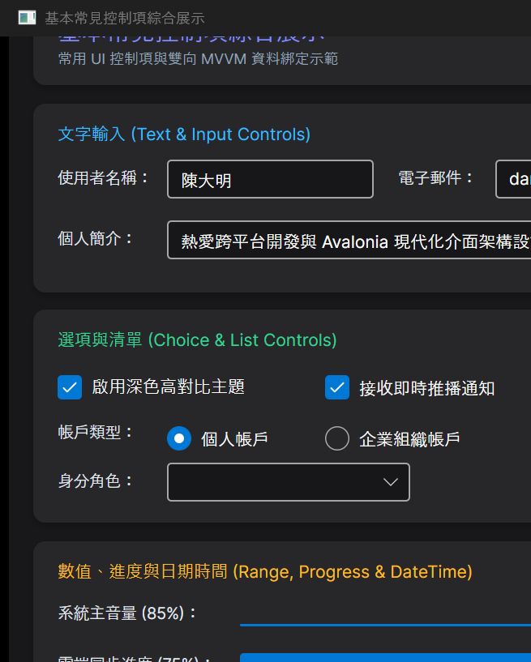

# 基本常見控制項綜合展示 (Basic Controls Showcase Example)

> 🎨 **Avalonia Form Generator (AFG)** 官方實機展示專案  
> 示範文字輸入、複選方塊、單選按鈕、下拉選單、清單檢視、數值拉桿、進度條與日期時間選擇器之全方位控制項運用與 MVVM 雙向資料綁定。

---

## 📸 實機畫面展示 (Showcase Gallery)

### 1. AFG 設計器視覺化編輯畫面 (Editor Design View)
呈現於 AFG 設計器中載入 `BasicControlsShowcase.afg.json` 之視覺化畫布、左側控制項工具箱與右側屬性檢查器：


### 2. 獨立實機運行與設定互動結果 (Runtime Result)
呈現跨平台桌面端實機渲染結果，包含即時拉桿數值回饋、複選框狀態聯動、帳戶類型切換與全域設定狀態總結摘要：



---

## 🌟 專案特色與架構 (Key Features & Architecture)

1. **豐富 UI 控制項整合**：一次展示 `TextBox`、`CheckBox`、`RadioButton`、`ComboBox`、`ListBox`、`Slider`、`ProgressBar`、`DatePicker`、`TimePicker` 等 9+ 種核心元件。
2. **現代純 C# Fluent Markup**：全 UI 由 AFG C# Fluent Markup 引擎生成，具備強型別編譯期檢查與極致效能。
3. **雙向 MVVM 資料綁定**：使用 `CommunityToolkit.Mvvm` 實現屬性聯動（例如拉桿數值自動更新文字標籤百分比，儲存按鈕即時產出格式化偏好摘要）。
4. **現代化卡片式視覺排版**：採用深色主題 (`#18181B`)、高質感圓角邊框 (`CornerRadius="10"`) 與柔和立體陰影 (`BoxShadow`)。

---

## 📁 檔案結構 (Directory Structure)

```text
example/BasicControlsShowcase/
├── BasicControlsShowcase.afg.json        # [核心 AST] AFG 視覺化設計專案檔
├── README.md                             # [說明文件] 專案導覽與實機操作手冊
├── screenshots/                          # [實機截圖]
│   ├── editor_design_view.png            # AFG 視覺化編輯器真實畫面
│   └── runtime_result.png                # 桌面端實機運行與互動畫面
├── BasicControlsShowcase.slnx            # Visual Studio 現代方案檔
└── src/                                  # [匯出專案] 完整跨平台可編譯原始碼
    ├── BasicControlsShowcase.Shared/     # 跨平台核心共用專案
    │   ├── BasicControlsShowcase.Shared.csproj
    │   ├── App.cs                        # 應用程式進入點與 DI 服務註冊
    │   ├── ViewModels/
    │   │   └── BasicControlsShowcaseViewModel.cs # MVVM 視圖模型
    │   └── Views/
    │       └── BasicControlsShowcaseView.cs      # Fluent C# Markup 宣告式介面
    └── BasicControlsShowcase.Desktop/    # 桌面端進入點專案
        ├── BasicControlsShowcase.Desktop.csproj
        └── Program.cs                    # 桌面平台進入點
```

---

## 🧩 UI 元件階層樹 (Component Hierarchy)

| 元件識別碼 (ID) | 控制項類型 | 座標 / 尺寸 | 綁定屬性 / 事件映射 | 說明 |
| :--- | :--- | :--- | :--- | :--- |
| **RootCanvas** | `Canvas` | `640 × 880` | — | 深色背景畫布 (`#18181B`) |
| **headerCard** | `Border` | `(20, 20) 600 × 70` | — | 頂部標題卡片，具備陰影與圓角 |
| ├── `txtHeaderTitle` | `TextBlock` | `(20, 12)` | Text: `"基本常見控制項綜合展示"` | 主標題 (20pt Bold, `#818CF8`) |
| └── `txtHeaderSubtitle` | `TextBlock` | `(20, 40)` | Text: `"常用 UI 控制項與雙向 MVVM 資料綁定示範"` | 副標題 (12pt, `#94A3B8`) |
| **inputCard** | `Border` | `(20, 105) 600 × 155`| — | 文字與個人輸入面板 |
| ├── `txtName` / `txtEmail` | `TextBox` | `(110, 46)` / `(380, 46)` | `Text` 雙向綁定 `UserName` / `Email` | 姓名與電子郵件欄位 |
| └── `txtBio` | `TextBox` | `(110, 92) 470 × 45` | `Text` 雙向綁定 `Bio` | 多行個人簡介 |
| **choiceCard** | `Border` | `(20, 275) 600 × 120`| — | 選擇控制項面板 |
| ├── `chkDarkMode` / `chkNotify` | `CheckBox` | `(20, 45)` / `(200, 45)` | `IsChecked` 雙向綁定 `IsDarkMode` / `ReceiveNotifications` | 深色主題與推播通知切換 |
| └── `rbPersonal` / `rbEnterprise` | `RadioButton` | `(20, 78)` / `(200, 78)` | `IsChecked` 雙向綁定 `IsPersonalAccount` / `IsEnterpriseAccount` | 個人與企業帳戶類型單選 |
| **sliderCard** | `Border` | `(20, 410) 600 × 140`| — | 數值與範圍調節面板 |
| ├── `sldVolume` | `Slider` | `(20, 45) 560 × 20` | `Value` 雙向綁定 `VolumeValue` (0~100) | 系統音量拉桿 |
| └── `pbProgress` | `ProgressBar` | `(20, 105) 560 × 14` | `Value` 單向綁定 `ProgressValue` (0~100) | 同步進度指示條 |
| **dateTimeCard** | `Border` | `(20, 565) 600 × 90` | — | 日期與時間選取器面板 |
| ├── `dpBirthday` | `DatePicker` | `(20, 40) 260 × 34` | — | 出生年月日選擇器 |
| └── `tpReminder` | `TimePicker` | `(320, 40) 260 × 34` | — | 每日提醒時間選擇器 |
| **btnSave** / **btnReset** | `Button` | `(20, 670)` / `(240, 670)` | `Click` 映射 `SaveSettingsCommand` / `ResetSettingsCommand` | 儲存與重設命令按鈕 |
| **summaryCard** | `Border` | `(20, 730) 600 × 130`| — | 設定總結與狀態回饋卡片 |
| └── `txtSummary` | `TextBlock` | `(20, 40) 560 × 75` | `Text` 單向綁定 `StatusSummary` | 即時格式化偏好摘要 |

---

## 🚀 如何執行本範例 (How to Run)

### 1. 於 AFG 視覺化設計器開啟
```powershell
dotnet run --project src/AFG.Desktop/AFG.Desktop.csproj "D:\P\CS\Avalonia Form Generator\example\BasicControlsShowcase\BasicControlsShowcase.afg.json"
```

### 2. 獨立編譯並啟動實機應用程式
```powershell
dotnet run --project example/BasicControlsShowcase/src/BasicControlsShowcase.Desktop/BasicControlsShowcase.Desktop.csproj
```
