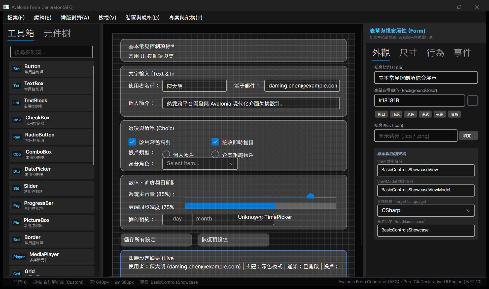

# 基本常見控制項綜合展示 (Basic Controls Showcase Example)

> 🎨 **Avalonia Form Generator (AFG)** 官方實機展示專案  
> 示範文字輸入、複選方塊、單選按鈕、下拉選單、清單檢視、數值拉桿、進度條與日期時間選擇器之全方位控制項運用與 MVVM 雙向資料綁定。

---

## 📸 實機畫面展示 (Showcase Gallery)

### 1. AFG 設計器視覺化編輯畫面 (Editor Design View)
呈現於 AFG 設計器中載入 `BasicControlsShowcase.afg.json` 之視覺化畫布、左側控制項工具箱與右側屬性檢查器：



### 2. 獨立實機運行與設定互動結果 (Runtime Result)
呈現跨平台桌面端實機渲染結果，包含即時拉桿數值回饋、複選框狀態聯動、帳戶類型切換與全域設定狀態總結摘要：


---

## 🌟 專案特色與架構 (Key Features & Architecture)

1. **豐富 UI 控制項整合**：一次展示 `TextBox`、`CheckBox`、`RadioButton`、`ComboBox`、`Slider`、`ProgressBar`、`DatePicker`、`TimePicker`、`Button` 等 9+ 種核心元件。
2. **現代純 C# Fluent Markup**：全 UI 由 AFG C# Fluent Markup 引擎生成，具備強型別編譯期檢查與極致效能。
3. **雙向 MVVM 資料綁定**：使用 `CommunityToolkit.Mvvm` 實現屬性聯動（例如拉桿數值自動更新文字標籤百分比，儲存按鈕即時產出格式化偏好摘要）。
4. **現代化卡片式視覺排版**：採用深色主題 (`#18181B`)、高質感圓角邊框 (`CornerRadius="10"`) 與柔和立體陰影 (`BoxShadow="0 4 8 0 #40000000"`)。

---

## 📁 檔案結構 (Directory Structure)

```text
example/BasicControlsShowcase/
├── BasicControlsShowcase.afg.json        # [核心 AST] AFG 視覺化設計專案檔
├── ShowcaseBuilder.cs                    # [純 C# AST 建構器] 宣告式中介語意樹與專案匯出示範
├── README.md                             # [說明文件] 專案導覽、C# 構建解析與操作手冊
├── screenshots/                          # [實機截圖]
│   ├── editor_design_view.png            # AFG 視覺化編輯器真實畫面 (全螢幕未裁剪)
│   └── runtime_result.png                # 桌面端實機運行畫面 (完整包含標題列與底部摘要卡片)
├── BasicControlsShowcase.slnx            # Visual Studio 現代方案檔
└── src/                                  # [匯出專案] 完整跨平台可編譯原始碼
    ├── BasicControlsShowcase.Shared/     # 跨平台核心共用專案
    │   ├── BasicControlsShowcase.Shared.csproj
    │   ├── App.cs                        # 應用程式進入點與 DI 服務註冊
    │   ├── Config.cs                     # 全域視窗尺寸與應用程式組態
    │   ├── ViewModels/
    │   │   └── BasicControlsShowcaseViewModel.cs # MVVM 視圖模型 (含業務驗證與命令邏輯)
    │   └── Views/
    │       └── BasicControlsShowcaseView.cs      # Fluent C# Markup 宣告式介面
    └── BasicControlsShowcase.Desktop/    # 桌面端進入點專案
        ├── BasicControlsShowcase.Desktop.csproj
        └── Program.cs                    # 桌面平台進入點
```

---

## 🧩 UI 元件階層樹 (Component Hierarchy)

全表單畫布設定為 `640 × 680`，採用立體卡片垂直分區排版：

| 元件識別碼 (ID) | 控制項類型 | 座標 / 尺寸 | 綁定屬性 / 事件映射 | 說明 |
| :--- | :--- | :--- | :--- | :--- |
| **RootCanvas** | `Canvas` | `640 × 680` | — | 深色背景畫布 (`#18181B`) |
| **headerCard** | `Border` | `(20, 15) 600 × 60` | — | 頂部標題卡片，具備陰影與圓角 (`#27272A`) |
| ├── `txtHeaderTitle` | `TextBlock` | `(20, 8)` | Text: `"基本常見控制項綜合展示"` | 主標題 (18pt Bold, `#818CF8`) |
| └── `txtHeaderSubtitle` | `TextBlock` | `(20, 34)` | Text: `"常用 UI 控制項與雙向 MVVM 資料綁定示範"` | 副標題 (12pt, `#94A3B8`) |
| **inputCard** | `Border` | `(20, 85) 600 × 135` | — | 文字輸入控制項卡片 (`#27272A`) |
| ├── `lblSec1` | `TextBlock` | `(20, 10)` | Text: `"文字輸入 (Text & Input Controls)"` | 區塊標題 (13pt Bold, `#38BDF8`) |
| ├── `lblName` / `txtName` | `TextBlock` / `TextBox` | `(20, 42)` / `(110, 36) 170 × 32` | `Text` 雙向綁定 `UserName` | 使用者名稱輸入框 (Watermark: 請輸入姓名) |
| ├── `lblEmail` / `txtEmail` | `TextBlock` / `TextBox` | `(300, 42)` / `(380, 36) 200 × 32` | `Text` 雙向綁定 `Email` | 電子郵件輸入框 (Watermark: 請輸入 Email) |
| └── `lblBio` / `txtBio` | `TextBlock` / `TextBox` | `(20, 88)` / `(110, 82) 470 × 32` | `Text` 雙向綁定 `Bio` | 個人簡介輸入框 (Watermark: 請輸入簡介) |
| **choiceCard** | `Border` | `(20, 230) 600 × 135`| — | 選項與清單控制項卡片 (`#27272A`) |
| ├── `lblSec2` | `TextBlock` | `(20, 10)` | Text: `"選項與清單 (Choice & List Controls)"` | 區塊標題 (13pt Bold, `#34D399`) |
| ├── `chkDarkMode` | `CheckBox` | `(20, 40)` | `IsChecked` 雙向綁定 `IsDarkMode` | 深色高對比主題開關 |
| ├── `chkNotifications` | `CheckBox` | `(240, 40)` | `IsChecked` 雙向綁定 `ReceiveNotifications` | 即時推播通知開關 |
| ├── `lblAccount` | `TextBlock` | `(20, 75)` | Text: `"帳戶類型："` | 標籤說明 |
| ├── `rbPersonal` | `RadioButton` | `(110, 73)` | `IsChecked` 雙向綁定 `IsPersonalAccount` | 個人帳戶單選鈕 |
| ├── `rbEnterprise` | `RadioButton` | `(240, 73)` | `IsChecked` 雙向綁定 `IsEnterpriseAccount` | 企業組織帳戶單選鈕 |
| └── `lblRole` / `cmbRole` | `TextBlock` / `ComboBox` | `(20, 104)` / `(110, 98) 200 × 28` | Content: `"資深系統架構師"` | 身分角色下拉選單 |
| **rangeCard** | `Border` | `(20, 375) 600 × 145`| — | 數值、進度與日期時間面板 (`#27272A`) |
| ├── `lblSec3` | `TextBlock` | `(20, 10)` | Text: `"數值、進度與日期時間..."` | 區塊標題 (13pt Bold, `#FBBF24`) |
| ├── `lblVolume` / `sldVolume` | `TextBlock` / `Slider` | `(20, 40)` / `(170, 36) 400 × 26` | `Text` <- `VolumeLabel` / `Value` <-> `VolumeValue` | 系統主音量拉桿 (0~100) |
| ├── `lblProgress` / `pbProgress` | `TextBlock` / `ProgressBar` | `(20, 75)` / `(170, 75) 400 × 16` | `Text` <- `ProgressLabel` / `Value` <-> `ProgressValue` | 雲端同步進度指示條 (0~100) |
| ├── `dpDate` | `DatePicker` | `(110, 103) 180 × 30` | — | 排程預約日期選擇器 |
| └── `tpTime` | `TimePicker` | `(310, 103) 150 × 30` | — | 排程預約時間選擇器 |
| **btnSave** | `Button` | `(20, 530) 190 × 36` | `Click` -> `SaveSettingsCommand` (Async) | 「儲存所有設定」主色按鈕 (`#4F46E5`) |
| **btnReset** | `Button` | `(225, 530) 190 × 36` | `Click` -> `ResetSettingsCommand` (Async) | 「恢復預設值」輔助按鈕 (`#3F3F46`) |
| **statusCard** | `Border` | `(20, 575) 600 × 95` | BorderBrush: `#3B82F6` (藍色邊框) | 即時設定摘要與狀態回饋卡片 (`#1E293B`) |
| ├── `lblStatusTitle` | `TextBlock` | `(20, 10)` | Text: `"即時設定摘要 (Live Summary)"` | 標題 (13pt Bold, `#60A5FA`) |
| └── `txtSummary` | `TextBlock` | `(20, 32) 560 × 55` | `Text` 雙向綁定 `StatusSummary` | 即時格式化設定總結輸出字串 |

---

## 💻 如何以 C# 程式碼撰寫此表單 (How to Build with C# Code)

除了在 AFG 視覺化設計器中以拖曳方式拉出介面外，AFG 還支援**純 C# 程式碼**宣告式建構 AST。在 [`ShowcaseBuilder.cs`](ShowcaseBuilder.cs) 中展示了完整的建構流程：

### 1. 建立 `FormDocument` 與根容器畫布

```csharp
using AFG.Core.Models;
using AFG.Core.Models.Ast;
using AFG.Core.Serialization;
using AFG.Generators.ProjectExport;

var document = new FormDocument
{
    SchemaVersion = "1.0",
    ProjectName = "BasicControlsShowcase",
    RootNamespace = "BasicControlsShowcase",
    Title = "基本常見控制項綜合展示",
    ViewClassName = "BasicControlsShowcaseView",
    ViewModelClassName = "BasicControlsShowcaseViewModel",
    CanvasWidth = 640,
    CanvasHeight = 680,
    BackgroundColor = "#18181B",
    TargetLanguage = TargetLanguage.CSharp,
    ArchitectureMode = ArchitectureMode.Hybrid,
    UseCompiledBindings = true,
    RootNode = new AstNode
    {
        Id = "rootCanvas",
        Name = "RootCanvas",
        Type = ControlType.Canvas,
        Width = 640,
        Height = 680,
        Children = [ /* 子卡片與元件集合 */ ]
    }
};
```

### 2. 卡片樣式與陰影設定 (Border, CornerRadius & BoxShadow)

透過 `CornerRadiusModel` 與 `BoxShadowModel`，可在純 C# 中設定現代深色卡片樣式：

```csharp
new AstNode
{
    Id = "inputCard",
    Name = "inputCard",
    Type = ControlType.Border,
    CanvasLeft = 20,
    CanvasTop = 85,
    Width = 600,
    Height = 135,
    Background = "#27272A",
    CornerRadius = new CornerRadiusModel(10, 10, 10, 10),
    BoxShadow = new BoxShadowModel(0, 4, 8, 0, "#40000000", false),
    Children = [ /* 控制項 */ ]
}
```

### 3. MVVM 雙向資料綁定 (TwoWay Binding)

透過 `Bindings` 集合附加 `BindingDefinition`，宣告式指派屬性與繫結模式：

```csharp
// 文字框雙向綁定 UserName
new AstNode
{
    Id = "txtName",
    Name = "txtName",
    Type = ControlType.TextBox,
    CanvasLeft = 110,
    CanvasTop = 36,
    Width = 170,
    Height = 32,
    Watermark = "請輸入姓名",
    Bindings = [new BindingDefinition("Text", "UserName", BindingMode.TwoWay)]
}

// 複選框雙向綁定 IsDarkMode
new AstNode
{
    Id = "chkDarkMode",
    Name = "chkDarkMode",
    Type = ControlType.CheckBox,
    CanvasLeft = 20,
    CanvasTop = 40,
    Content = "啟用深色高對比主題",
    Bindings = [new BindingDefinition("IsChecked", "IsDarkMode", BindingMode.TwoWay)]
}

// 音量拉桿雙向綁定 VolumeValue
new AstNode
{
    Id = "sldVolume",
    Name = "sldVolume",
    Type = ControlType.Slider,
    CanvasLeft = 170,
    CanvasTop = 36,
    Width = 400,
    Height = 26,
    Minimum = 0,
    Maximum = 100,
    Bindings = [new BindingDefinition("Value", "VolumeValue", BindingMode.TwoWay)]
}
```

### 4. 按鈕事件映射至非同步命令 (Async RelayCommand)

透過 `Events` 集合將原生事件（如 `Click`）直接映射為 ViewModel 上的命令屬性：

```csharp
new AstNode
{
    Id = "btnSave",
    Name = "btnSave",
    Type = ControlType.Button,
    CanvasLeft = 20,
    CanvasTop = 530,
    Width = 190,
    Height = 36,
    Content = "儲存所有設定",
    Background = "#4F46E5",
    Foreground = "#FFFFFF",
    CornerRadius = new CornerRadiusModel(8, 8, 8, 8),
    Events = [new EventMappingDefinition { EventName = "Click", CommandProperty = "SaveSettingsCommand", IsAsync = true }]
}
```

### 5. 序列化為 JSON 與全方案匯出

```csharp
// 1. 序列化儲存為 .afg.json 設計檔
var json = AfgSerializer.SerializeDocument(document);
File.WriteAllText("BasicControlsShowcase.afg.json", json);

// 2. 透過 ProjectExportService 匯出完整的跨平台專案
var exportService = new ProjectExportService();
await exportService.ExportToFolderAsync(document, "output/BasicControlsShowcase", new ProjectExportOptions(
    IncludeMobileProject: false,
    CustomProjectName: "BasicControlsShowcase"
));
```

---

## ⚡ MVVM 業務邏輯與即時狀態同步 (ViewModel Architecture)

在 [`BasicControlsShowcaseViewModel.cs`](src/BasicControlsShowcase.Shared/ViewModels/BasicControlsShowcaseViewModel.cs) 中，實作了完整的響應式屬性聯動與命令邏輯：

1. **拉桿數值即時同步標籤百分比**：
   使用 `CommunityToolkit.Mvvm` 原始碼生成之分部方法（Partial Methods）即時反應：
   ```csharp
   partial void OnVolumeValueChanged(double value)
   {
       VolumeLabel = $"系統主音量 ({value:F0}%)：";
   }

   partial void OnProgressValueChanged(double value)
   {
       ProgressLabel = $"雲端同步進度 ({value:F0}%)：";
   }
   ```

2. **單選按鈕互斥聯動**：
   ```csharp
   partial void OnIsPersonalAccountChanged(bool value)
   {
       if (value && IsEnterpriseAccount) IsEnterpriseAccount = false;
   }

   partial void OnIsEnterpriseAccountChanged(bool value)
   {
       if (value && IsPersonalAccount) IsPersonalAccount = false;
   }
   ```

3. **儲存設定命令 (`SaveSettingsAsync`)**：
   執行非同步持久化前先進行基礎欄位防呆檢驗（姓名不得為空、電子郵件需包含 `@` 與 `.`），檢核通過後自動附加時間戳記與全欄位設定狀態至 `StatusSummary`：
   ```csharp
   [RelayCommand]
   private async Task SaveSettingsAsync()
   {
       await Task.Delay(50);
       var timestamp = DateTime.Now.ToString("yyyy-MM-dd HH:mm:ss");

       if (string.IsNullOrWhiteSpace(UserName))
       {
           StatusSummary = $"[{timestamp}] ⚠️ 儲存失敗：使用者名稱不可為空！";
           return;
       }

       if (string.IsNullOrWhiteSpace(Email) || !Email.Contains('@') || !Email.Contains('.'))
       {
           StatusSummary = $"[{timestamp}] ⚠️ 儲存失敗：電子郵件格式無效 ({Email})！";
           return;
       }

       var theme = IsDarkMode ? "深色模式" : "淺色模式";
       var notifications = ReceiveNotifications ? "已開啟" : "已關閉";
       var accountType = IsPersonalAccount ? "個人帳戶" : (IsEnterpriseAccount ? "企業帳戶" : "未指定");
       var bioBrief = string.IsNullOrWhiteSpace(Bio) ? "未填寫" : (Bio.Length > 20 ? Bio[..20] + "..." : Bio);

       StatusSummary = $"[{timestamp}] ✅ 偏好設定儲存成功 | 使用者：{UserName} ({Email}) | 主題：{theme} | 通知：{notifications} | 帳戶：{accountType} | 音量：{VolumeValue:F0}% | 進度：{ProgressValue:F0}% | 簡介：{bioBrief}";
   }
   ```

4. **恢復預設值命令 (`ResetSettingsAsync`)**：
   將所有控制項數值還原為官方標準預設值，並即時產出重設成功紀錄。

---

## 🚀 如何執行本範例 (How to Run)

### 1. 於 AFG 視覺化設計器開啟
```powershell
dotnet run --project src/AFG.Desktop/AFG.Desktop.csproj "D:\P\CS\Avalonia Form Generator\example\BasicControlsShowcase\BasicControlsShowcase.afg.json"
```

### 2. 獨立編譯並啟動實機應用程式
```powershell
dotnet run --project example/BasicControlsShowcase/src/BasicControlsShowcase.Desktop/BasicControlsShowcase.Desktop.csproj
```

### 3. 自動重新擷取實機截圖
```powershell
powershell.exe -ExecutionPolicy Bypass -File tools\capture_showcases.ps1 BasicControlsShowcase
```
截圖將自動更新於 `example/BasicControlsShowcase/screenshots/` 目錄：
- `editor_design_view.png`：1942×1150 全螢幕無裁切之 AFG 編輯器介面。
- `runtime_result.png`：982×1076 完整實機運行介面，包含頂部標題列與底部設定摘要卡片。
