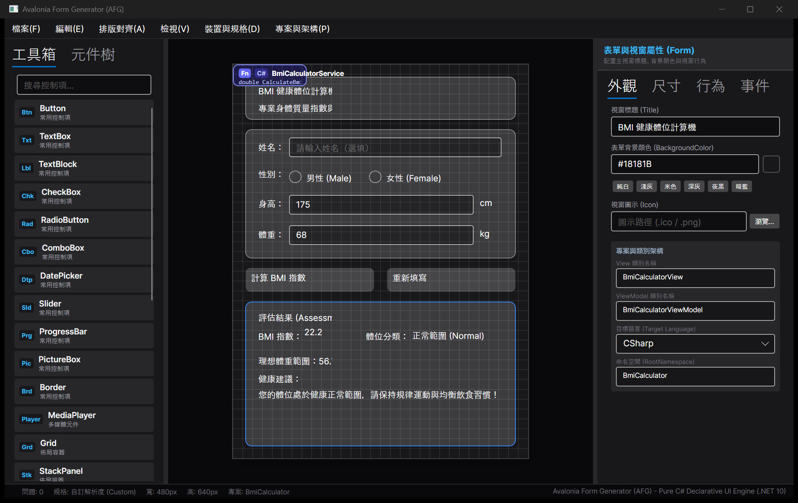
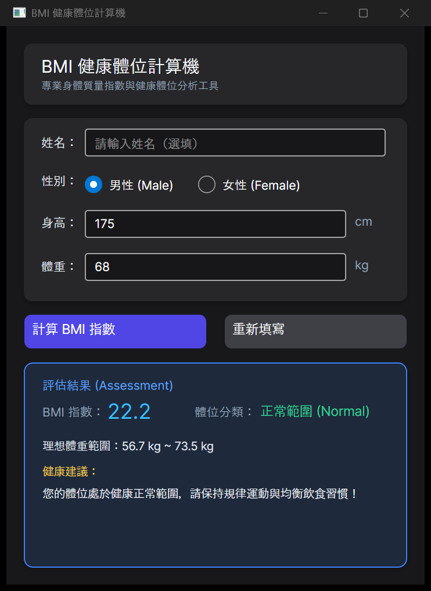

# BMI 健康體位評估計算機 (BMI Calculator Example)

> 🎨 **Avalonia Form Generator (AFG)** 官方實機展示專案  
> 具備純 C# Fluent Markup、MVVM 資料綁定、Roslyn 程式碼生成與多專案跨平台分層架構之真實範例。

---

## 📸 實機畫面展示 (Showcase Gallery)

### 1. AFG 設計器視覺化編輯畫面 (Editor Design View)
呈現於 AFG 設計器中載入 `BmiCalculator.afg.json` 之視覺化畫布、左側控制項工具箱與右側屬性檢查器：



### 2. 獨立實機運行與即時計算結果 (Runtime Result)
呈現跨平台桌面端執行程式實機渲染結果，具備預填數值（身高 175 cm、體重 68 kg）、BMI 數值計算（22.2）、體位分類徽章（正常範圍）與衛教生活建議：



---

## 🌟 專案特色與架構 (Key Features & Architecture)

本範例專案完整展示了 AFG 表單生成器的全生命週期：
1. **中介模型抽象化 (AST-Driven)**：完全由 `BmiCalculator.afg.json` 定義佈局、控制項樣式、資料綁定與業務邏輯原型。
2. **純 C# 宣告式 UI (Fluent C# Markup)**：摒棄傳統 XAML 標籤，採用強型別、具備編譯期型別檢查與極致效能之純 C# Fluent Extension 鏈式語法。
3. **現代 MVVM 架構**：透過 `CommunityToolkit.Mvvm` 自動產生 `[ObservableProperty]` 與 `[RelayCommand]`，落實視圖與商業邏輯解耦。
4. **業務邏輯原型注入 (Logic Function)**：整合 AFG Phase 27 的業務邏輯元件，自動生成獨立服務介面 (`IBmiCalculatorService`) 與純函數實作 (`BmiCalculatorService.CalculateBmi`)。
5. **分層多專案方案 (.slnx)**：由 `ProjectExportService` 匯出符合 .NET 10 / C# 14 標準之企業級跨平台專案結構。

---

## 📁 檔案結構 (Directory Structure)

```text
example/BmiCalculator/
├── BmiCalculator.afg.json           # [核心 AST] AFG 視覺化設計專案檔
├── README.md                        # [說明文件] 專案導覽與實機操作手冊
├── screenshots/                     # [實機截圖]
│   ├── editor_design_view.png       # AFG 視覺化編輯器真實畫面
│   └── runtime_result.png           # 桌面端實機運行與計算結果畫面
└── src/                             # [匯出專案] 完整跨平台可編譯原始碼
    ├── BmiCalculator.slnx           # Visual Studio 現代方案檔
    ├── BmiCalculator.Shared/        # 跨平台核心共用專案
    │   ├── BmiCalculator.Shared.csproj
    │   ├── App.cs                   # 應用程式進入點與 DI 服務註冊
    │   ├── Config.cs                # 全域配置與視窗尺寸參數
    │   ├── GlobalUsings.cs          # 全域引用命名空間
    │   ├── Markup/
    │   │   └── AvaloniaMarkupExtensions.cs # Fluent C# Markup 擴充方法庫
    │   ├── Services/
    │   │   ├── IBmiCalculatorService.cs    # 業務邏輯服務介面
    │   │   └── BmiCalculatorService.cs     # 業務邏輯純函數實作
    │   ├── ViewModels/
    │   │   └── BmiCalculatorViewModel.cs   # MVVM 視圖模型（體位判定與命令）
    │   └── Views/
    │       └── BmiCalculatorView.cs        # Fluent C# Markup 宣告式介面
    └── BmiCalculator.Desktop/       # 桌面端進入點專案
        ├── BmiCalculator.Desktop.csproj
        └── Program.cs               # 桌面平台進入點 (ClassicDesktopStyleLifetime)
```

---

## 🧩 UI 元件階層樹 (Component Hierarchy)

| 元件識別碼 (ID) | 控制項類型 | 座標 / 尺寸 | 綁定屬性 / 事件映射 | 說明 |
| :--- | :--- | :--- | :--- | :--- |
| **RootCanvas** | `Canvas` | `480 × 640` | — | 深色背景畫布 (`#18181B`) |
| **headerCard** | `Border` | `(20, 20) 440 × 70` | — | 頂部標題卡片，具備陰影與圓角 |
| ├── `txtHeaderTitle` | `TextBlock` | `(20, 12)` | Text: `"BMI 健康體位計算機"` | 主標題 (20pt Bold, `#F8FAFC`) |
| └── `txtHeaderSubtitle` | `TextBlock` | `(20, 40)` | Text: `"專業身體質量指數與健康體位分析工具"` | 副標題 (12pt, `#94A3B8`) |
| **inputCard** | `Border` | `(20, 105) 440 × 210`| — | 身高、體重與性別輸入面板 |
| ├── `lblUserName` / `txtName` | `TextBlock` / `TextBox` | `(20, 18)` / `(70, 12)` | `Text` 雙向綁定 `UserName` | 姓名輸入欄位 |
| ├── `lblGender` | `TextBlock` | `(20, 62)` | Text: `"性別："` | 性別標籤 |
| ├── `rbMale` | `RadioButton` | `(70, 60)` | `IsChecked` 雙向綁定 `IsMale` | 生理男性單選框 |
| ├── `rbFemale` | `RadioButton` | `(200, 60)` | `IsChecked` 雙向綁定 `IsFemale` | 生理女性單選框 |
| ├── `lblHeight` / `txtHeight` | `TextBlock` / `TextBox` | `(20, 110)` / `(70, 105)` | `Text` 雙向綁定 `HeightCm` | 身高輸入欄位 (cm) |
| └── `lblWeight` / `txtWeight` | `TextBlock` / `TextBox` | `(20, 160)` / `(70, 155)` | `Text` 雙向綁定 `WeightKg` | 體重輸入欄位 (kg) |
| **btnCalculate** | `Button` | `(20, 330) 210 × 40` | `Click` 映射 `CalculateCommand` | 計算按鈕 (靛藍色 `#4F46E5`) |
| **btnReset** | `Button` | `(250, 330) 210 × 40` | `Click` 映射 `ResetCommand` | 重設按鈕 (深灰色 `#3F3F46`) |
| **resultCard** | `Border` | `(20, 385) 440 × 235`| — | 評估結果呈現卡片 (藍色外框) |
| ├── `txtResultTitle` | `TextBlock` | `(20, 15)` | Text: `"評估結果 (Assessment)"` | 結果標題 (14pt, `#60A5FA`) |
| ├── `txtBmiValue` | `TextBlock` | `(95, 40)` | `Text` 單向綁定 `BmiValue` | BMI 數值大型文字 (24pt, `#38BDF8`) |
| ├── `txtCategory` | `TextBlock` | `(270, 44)` | `Text` 單向綁定 `BmiCategory` | 體位分類標籤 (綠色 `#34D399`) |
| ├── `txtIdealWeight` | `TextBlock` | `(20, 85)` | `Text` 單向綁定 `IdealWeightRange` | 理想體重範圍提示 |
| └── `txtAdvice` | `TextBlock` | `(20, 140) 400 × 80` | `Text` 單向綁定 `HealthAdvice` | 個人化健康建議文字方塊 |
| **logic_bmi** | `LogicFunction` | — | `BmiCalculatorService.CalculateBmi` | BMI 計算業務邏輯函數原型 |

---

## 🧮 衛福部體位判定與計算標準 (Calculation Rules)

1. **身體質量指數計算公式**：
   $$\text{BMI} = \frac{\text{體重 (kg)}}{\left(\frac{\text{身高 (cm)}}{100}\right)^2}$$
2. **台灣衛福部 (國民健康署) 體位判定標準**：
   * $\text{BMI} < 18.5$：**體重過輕 (Underweight)**
   * $18.5 \le \text{BMI} < 24$：**正常範圍 (Normal, 建議理想體位)**
   * $24 \le \text{BMI} < 27$：**過重 (Overweight)**
   * $27 \le \text{BMI} < 30$：**輕度肥胖 (Mild Obesity)**
   * $30 \le \text{BMI} < 35$：**中度肥胖 (Moderate Obesity)**
   * $\text{BMI} \ge 35$：**重度肥胖 (Severe Obesity)**
3. **理想體重推算公式**：
   $$\text{理想體重下限} = 18.5 \times \left(\frac{\text{身高}}{100}\right)^2, \quad \text{理想體重上限} = 24.0 \times \left(\frac{\text{身高}}{100}\right)^2$$

---

## 🚀 快速啟動與操作說明 (Quick Start)

### 方法 1：於 AFG 設計器中開啟並編輯
使用 AFG 桌面端設計器載入本範例專案檔：
```powershell
dotnet run --project src/AFG.Desktop/AFG.Desktop.csproj -- "example/BmiCalculator/BmiCalculator.afg.json"
```
* 開啟後即可於視覺化畫布中拖曳微調控制項、在右側檢查器調整屬性，或按下 <kbd>F5</kbd> 啟動即時動態表單預覽。

### 方法 2：直接編譯並執行匯出的實機專案
本範例已包含完整可編譯之桌面端獨立方案：
```powershell
# 建置並啟動 BMI 計算機桌面程式
dotnet run --project example/BmiCalculator/src/BmiCalculator.Desktop/BmiCalculator.Desktop.csproj
```
* 程式啟動後可即時輸入身高、體重與性別，點擊「**計算 BMI 指數**」立即更新 BMI 數值、體位區間與衛教建議；點擊「**重新填寫**」可清空重填。
