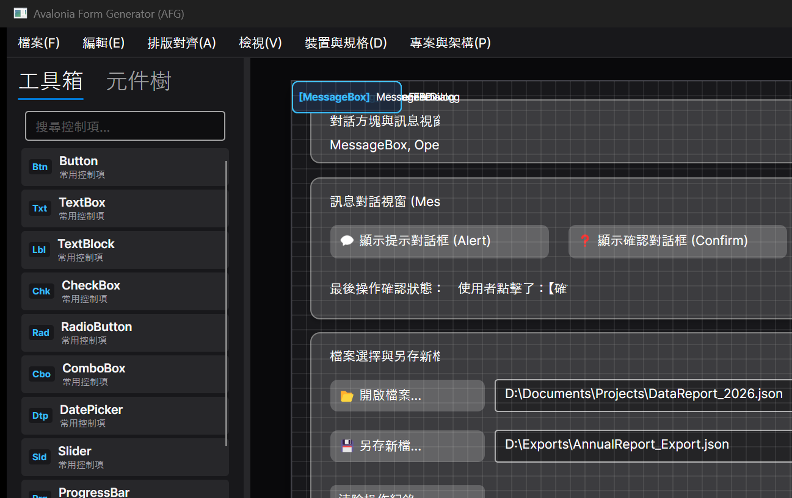

# 對話方塊與訊息視窗之運用 (Dialogs Showcase Example)

> 🎨 **Avalonia Form Generator (AFG)** 官方實機展示專案  
> 示範訊息提示框 (`MessageBox`)、確認對話框 (`ConfirmBox`)、開啟檔案選取器 (`OpenFileDialog`)、儲存檔案選取器 (`SaveFileDialog`) 與相依性注入架構 (`IDialogService`) 的全方位整合運用。

---

## 📸 實機畫面展示 (Showcase Gallery)

### 1. AFG 設計器視覺化編輯畫面 (Editor Design View)
呈現於 AFG 設計器中載入 `DialogsShowcase.afg.json` 之視覺化畫布、對話框按鈕與操作日誌面板：



### 2. 獨立實機運行與對話框交互結果 (Runtime Result)
呈現桌面端實機執行結果，包含檔案選取路徑回饋、訊息彈窗確認結果以及即時操作時間戳日誌：


---

## 🌟 專案特色與架構 (Key Features & Architecture)

1. **不可視服務注入 (Non-Visual Dialog Services)**：AFG 支援將 `MessageBox`、`OpenFileDialog` 與 `SaveFileDialog` 作為不可視元件放入設計器 AST 中，由專案匯出服務自動產生強型別 `IDialogService` 與預設實作。
2. **ViewModel 解耦**：視圖模型透過非同步命令 (`OpenFileCommand`, `SaveFileCommand`, `ShowAlertCommand`, `ShowConfirmCommand`) 調用對話框，完全解耦 UI 視窗實體。
3. **即時日誌追蹤**：提供歷史操作紀錄面板，支援多行卷軸檢視與一鍵清空功能。

---

## 📁 檔案結構 (Directory Structure)

```text
example/DialogsShowcase/
├── DialogsShowcase.afg.json        # [核心 AST] AFG 視覺化設計專案檔
├── README.md                       # [說明文件] 專案導覽與實機操作手冊
├── screenshots/                    # [實機截圖]
│   ├── editor_design_view.png      # AFG 視覺化編輯器真實畫面
│   └── runtime_result.png          # 桌面端實機運行畫面
├── DialogsShowcase.slnx            # Visual Studio 現代方案檔
└── src/                            # [匯出專案] 完整跨平台可編譯原始碼
    ├── DialogsShowcase.Shared/     # 跨平台核心共用專案
    │   ├── DialogsShowcase.Shared.csproj
    │   ├── App.cs                  # DI 容器與對話框服務註冊
    │   ├── Services/
    │   │   ├── IDialogService.cs   # 對話框服務介面
    │   │   ├── DialogService.cs    # 跨平台對話框服務實作
    │   │   ├── MessageBox.cs       # 訊息提示視窗服務
    │   │   ├── OpenFileDialog.cs   # 開啟檔案對話框服務
    │   │   └── SaveFileDialog.cs   # 儲存檔案對話框服務
    │   ├── ViewModels/
    │   │   └── DialogsShowcaseViewModel.cs
    │   └── Views/
    │       └── DialogsShowcaseView.cs
    └── DialogsShowcase.Desktop/    # 桌面端進入點專案
        ├── DialogsShowcase.Desktop.csproj
        └── Program.cs
```

---

## 🧩 UI 元件階層樹 (Component Hierarchy)

| 元件識別碼 (ID) | 控制項類型 | 座標 / 尺寸 | 綁定屬性 / 事件映射 | 說明 |
| :--- | :--- | :--- | :--- | :--- |
| **RootCanvas** | `Canvas` | `640 × 740` | — | 深色背景畫布 (`#18181B`) |
| **headerCard** | `Border` | `(20, 20) 600 × 70` | — | 頂部標題卡片 |
| ├── `txtHeaderTitle` | `TextBlock` | `(20, 12)` | Text: `"對話方塊與訊息視窗之運用"` | 主標題 (20pt Bold, `#818CF8`) |
| └── `txtHeaderSubtitle` | `TextBlock` | `(20, 40)` | Text: `"展示 MessageBox 與 FileDialogs 整合應用"` | 副標題 (12pt, `#94A3B8`) |
| **msgCard** | `Border` | `(20, 105) 600 × 125`| — | 訊息提示與確認對話框卡片 |
| ├── `btnShowAlert` | `Button` | `(20, 48) 180 × 36` | `Click` 映射 `ShowAlertCommand` | 觸發提示訊息按鈕 (`#3B82F6`) |
| ├── `btnShowConfirm` | `Button` | `(220, 48) 180 × 36`| `Click` 映射 `ShowConfirmCommand` | 觸發確認訊息按鈕 (`#6366F1`) |
| └── `txtConfirmResult` | `TextBlock` | `(20, 95)` | `Text` 單向綁定 `ConfirmResultText` | 顯示確認對話框回傳之結果標籤 |
| **fileCard** | `Border` | `(20, 245) 600 × 185`| — | 檔案選取與儲存卡片 |
| ├── `btnOpenFile` | `Button` | `(20, 48) 180 × 36` | `Click` 映射 `OpenFileCommand` | 開啟檔案選取器按鈕 (`#10B981`) |
| ├── `txtOpenFileResult` | `TextBlock` | `(20, 95)` | `Text` 單向綁定 `SelectedOpenFilePath` | 選取之來源檔案路徑 |
| ├── `btnSaveFile` | `Button` | `(20, 125) 180 × 36`| `Click` 映射 `SaveFileCommand` | 另存新檔選取器按鈕 (`#F59E0B`) |
| └── `txtSaveFileResult` | `TextBlock` | `(20, 158)` | `Text` 單向綁定 `SelectedSaveFilePath` | 選取之目標檔案路徑 |
| **logCard** | `Border` | `(20, 445) 600 × 265`| — | 對話框歷史日誌卡片 |
| ├── `btnClearLogs` | `Button` | `(480, 12) 100 × 30` | `Click` 映射 `ClearLogsCommand` | 清空日誌按鈕 |
| └── `txtDialogLog` | `TextBlock` | `(20, 48) 560 × 195` | `Text` 單向綁定 `DialogLogText` | 多行操作事件歷程日誌 |

---

## 🚀 如何執行本範例 (How to Run)

### 1. 於 AFG 視覺化設計器開啟
```powershell
dotnet run --project src/AFG.Desktop/AFG.Desktop.csproj "D:\P\CS\Avalonia Form Generator\example\DialogsShowcase\DialogsShowcase.afg.json"
```

### 2. 獨立編譯並啟動實機應用程式
```powershell
dotnet run --project example/DialogsShowcase/src/DialogsShowcase.Desktop/DialogsShowcase.Desktop.csproj
```
