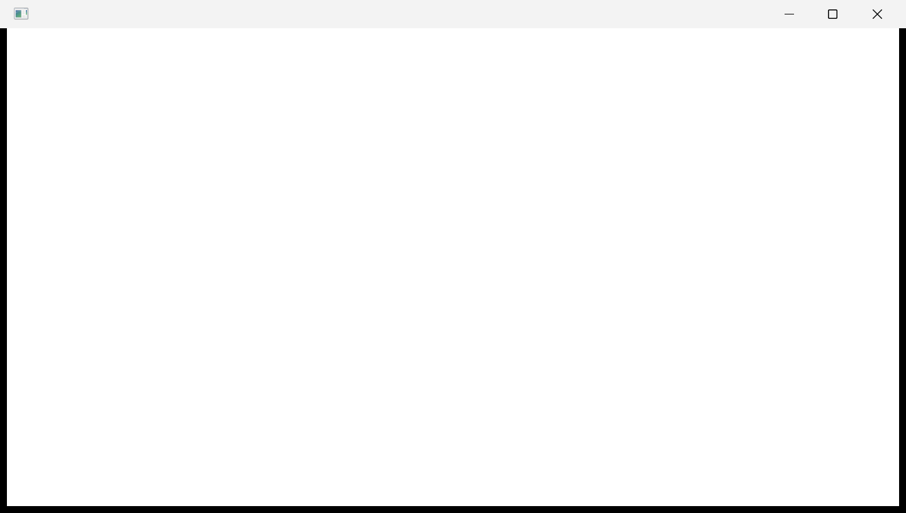

# 對話方塊與訊息視窗之運用 (Dialogs Showcase Example)

> 🎨 **Avalonia Form Generator (AFG)** 官方實機展示專案  
> 示範訊息提示框 (`MessageBox`)、確認對話框 (`ConfirmBox`)、開啟檔案選取器 (`OpenFileDialog`)、儲存檔案選取器 (`SaveFileDialog`) 與相依性注入架構 (`IDialogService`) 的全方位整合運用與純 C# AST 宣告式建構。

---

## 📸 實機畫面展示 (Showcase Gallery)

### 1. AFG 設計器視覺化編輯畫面 (Editor Design View)
呈現於 AFG 設計器中載入 `DialogsShowcase.afg.json` 之視覺化畫布、對話框按鈕與操作日誌面板：


### 2. 獨立實機運行與對話框交互結果 (Runtime Result)
呈現桌面端實機執行結果，包含檔案選取路徑回饋、訊息彈窗確認結果以及即時操作時間戳日誌：



---

## 🌟 專案特色與架構 (Key Features & Architecture)

1. **不可視服務注入 (Non-Visual Dialog Services)**：AFG 支援將 `MessageBox`、`OpenFileDialog` 與 `SaveFileDialog` 作為不可視元件放入設計器 AST 中，由專案匯出服務自動產生強型別 `IDialogService` 與預設實作。
2. **ViewModel 解耦**：視圖模型透過非同步命令 (`OpenFileCommand`, `SaveFileCommand`, `ShowAlertCommand`, `ShowConfirmCommand`) 調用對話框，完全解耦 UI 視窗實體。
3. **即時日誌追蹤**：提供歷史操作紀錄面板，支援多行卷軸檢視與一鍵清空功能。
4. **純 C# AST 宣告式定義**：提供 `ShowcaseBuilder.cs`，示範如何以強型別 C# 程式碼構建完整的 `FormDocument` 與 `AstNode` 語意樹，支援編譯期型別檢查與無縫匯出。

---

## 📁 檔案結構 (Directory Structure)

```text
example/DialogsShowcase/
├── DialogsShowcase.afg.json        # [核心 AST] AFG 視覺化設計專案檔
├── ShowcaseBuilder.cs              # [C# AST 建構器] 純 C# 程式碼建構表單與匯出示範
├── README.md                       # [說明文件] 專案導覽與實機操作手冊
├── screenshots/                    # [實機截圖]
│   ├── editor_design_view.png      # AFG 視覺化編輯器真實畫面
│   └── runtime_result.png          # 桌面端實機運行畫面
├── DialogsShowcase.slnx            # Visual Studio 現代方案檔
└── src/                            # [匯出專案] 完整跨平台可編譯原始碼
    ├── DialogsShowcase.Shared/     # 跨平台核心共用專案
    │   ├── DialogsShowcase.Shared.csproj
    │   ├── App.cs                  # DI 容器與對話框服務註冊
    │   ├── Config.cs               # 視窗配置與全域參數
    │   ├── Services/
    │   │   ├── IDialogService.cs   # 對話框服務介面
    │   │   ├── DialogService.cs    # 跨平台對話框服務實作
    │   │   ├── MessageBox.cs       # 訊息提示視窗服務
    │   │   ├── MessageBoxWindow.cs # 跨平台深色主題訊息視窗
    │   │   ├── OpenFileDialog.cs   # 開啟檔案對話框服務
    │   │   └── SaveFileDialog.cs   # 儲存檔案對話框服務
    │   ├── ViewModels/
    │   │   └── DialogsShowcaseViewModel.cs # 實作完整非同步互動業務邏輯
    │   └── Views/
    │       └── DialogsShowcaseView.cs      # Fluent C# Markup 宣告式介面
    └── DialogsShowcase.Desktop/    # 桌面端進入點專案
        ├── DialogsShowcase.Desktop.csproj
        └── Program.cs
```

---

## 🧩 UI 元件階層樹 (Component Hierarchy)

| 元件識別碼 (ID) | 控制項類型 | 座標 / 尺寸 | 綁定屬性 / 事件映射 | 說明 |
| :--- | :--- | :--- | :--- | :--- |
| **RootCanvas** | `Canvas` | `600 × 680` | — | 深色背景畫布 (`#18181B`) |
| **headerCard** | `Border` | `(20, 20) 560 × 70` | — | 頂部標題卡片，具備立體陰影與圓角 |
| ├── `txtHeaderTitle` | `TextBlock` | `(20, 12)` | Text: `"對話方塊與訊息視窗展示"` | 主標題 (20pt Bold, `#818CF8`) |
| └── `txtHeaderSubtitle` | `TextBlock` | `(20, 40)` | Text: `"MessageBox, OpenFileDialog, SaveFileDialog & IDialogService"` | 副標題 (12pt, `#94A3B8`) |
| **msgBoxCard** | `Border` | `(20, 105) 560 × 155`| — | 訊息提示與確認對話框卡片 |
| ├── `lblSec1` | `TextBlock` | `(20, 15)` | Text: `"訊息對話視窗 (MessageBox Demonstrations)"` | 區塊標題 (14pt Bold, `#38BDF8`) |
| ├── `btnAlert` | `Button` | `(20, 50) 240 × 38` | `Click` 映射 `ShowAlertCommand` | 觸發提示訊息按鈕 (`#0284C7`) |
| ├── `btnConfirm` | `Button` | `(280, 50) 240 × 38`| `Click` 映射 `ShowConfirmCommand` | 觸發確認訊息按鈕 (`#E11D48`) |
| ├── `lblConfirmStatus` | `TextBlock` | `(20, 110)` | Text: `"最後操作確認狀態："` | 狀態說明標籤 (`#94A3B8`) |
| └── `txtConfirmResult` | `TextBlock` | `(160, 110)` | `Text` 綁定 `ConfirmResultText` | 顯示確認對話框回傳結果 (`#34D399`) |
| **fileCard** | `Border` | `(20, 275) 560 × 220`| — | 檔案選取與儲存卡片 |
| ├── `lblSec2` | `TextBlock` | `(20, 15)` | Text: `"檔案選擇與另存新檔 (Open/Save File Dialogs)"` | 區塊標題 (14pt Bold, `#34D399`) |
| ├── `btnOpenFile` | `Button` | `(20, 50) 170 × 36` | `Click` 映射 `OpenFileCommand` | 開啟檔案選取器按鈕 (`#4F46E5`) |
| ├── `txtOpenPath` | `TextBox` | `(200, 50) 340 × 36`| `Text` 雙向綁定 `SelectedOpenFilePath` | 選取之來源檔案路徑文字方塊 |
| ├── `btnSaveFile` | `Button` | `(20, 105) 170 × 36`| `Click` 映射 `SaveFileCommand` | 另存新檔選取器按鈕 (`#059669`) |
| ├── `txtSavePath` | `TextBox` | `(200, 105) 340 × 36`| `Text` 雙向綁定 `SelectedSaveFilePath` | 另存目標檔案路徑文字方塊 |
| └── `btnClearLogs` | `Button` | `(20, 165) 170 × 34`| `Click` 映射 `ClearLogsCommand` | 清除操作紀錄按鈕 (`#3F3F46`) |
| **logCard** | `Border` | `(20, 510) 560 × 145`| — | 對話框歷史日誌卡片 (藍色高亮邊框) |
| ├── `lblLogTitle` | `TextBlock` | `(20, 12)` | Text: `"對話方塊調用日誌 (Dialog Invocation History)"` | 日誌標題 (13pt Bold, `#60A5FA`) |
| └── `txtLogHistory` | `TextBlock` | `(20, 40) 520 × 90` | `Text` 綁定 `DialogLogText` | 多行操作事件歷程日誌 (`#CBD5E1`) |
| **openDlg** | `OpenFileDialog` | 不可視 | — | 抽象對話框元件，自動注入 `IDialogService` |
| **saveDlg** | `SaveFileDialog` | 不可視 | — | 抽象對話框元件，自動注入 `IDialogService` |
| **msgBox** | `MessageBox` | 不可視 | — | 抽象對話框元件，自動注入 `IDialogService` |

---

## 💻 如何以 C# 程式碼撰寫此表單 (How to Build with C# Code)

除了透過 AFG 視覺化設計器拖曳產生，您亦可使用純 C# 程式碼直接建構整份表單中介語意樹 (`FormDocument` AST)。本範例提供獨立的 [`ShowcaseBuilder.cs`](ShowcaseBuilder.cs)，以下逐步解析其核心組成：

### 1. 建立根文件模型與畫布 (FormDocument & RootCanvas)
使用 C# 物件初值設定式宣告視窗屬性（標題、畫布尺寸、深色背景、DI 與編譯綁定開關）及根畫布節點：

```csharp
var document = new FormDocument
{
    SchemaVersion = "1.0",
    ProjectName = "DialogsShowcase",
    RootNamespace = "DialogsShowcase",
    ViewClassName = "DialogsShowcaseView",
    ViewModelClassName = "DialogsShowcaseViewModel",
    Title = "對話方塊與訊息視窗展示",
    BackgroundColor = "#18181B",
    CanvasWidth = 600,
    CanvasHeight = 680,
    WindowStartupLocation = WindowStartupLocation.CenterScreen,
    WindowState = WindowState.Normal,
    CanResize = true,
    EnableDependencyInjection = true,
    UseCompiledBindings = true,
    ArchitectureMode = ArchitectureMode.Hybrid,
    RootNode = new AstNode
    {
        Id = "rootCanvas",
        Name = "RootCanvas",
        Type = ControlType.Canvas,
        Width = 600,
        Height = 680,
        Children = [ /* 四大卡片與不可視元件 */ ]
    }
};
```

### 2. 建立卡片元件與樣式 (Cards & Styling)
透過設定 `CornerRadiusModel` 與 `BoxShadowModel` 打造現代化立體質感邊框：

```csharp
private static AstNode BuildHeaderCard() => new()
{
    Id = "headerCard",
    Name = "headerCard",
    Type = ControlType.Border,
    CanvasLeft = 20,
    CanvasTop = 20,
    Width = 560,
    Height = 70,
    Background = "#27272A",
    CornerRadius = CornerRadiusModel.Uniform(10),
    BoxShadow = new BoxShadowModel { OffsetX = 0, OffsetY = 4, Blur = 8, Color = "#40000000" },
    Children =
    [
        new AstNode
        {
            Id = "txtHeaderTitle",
            Type = ControlType.TextBlock,
            CanvasLeft = 20,
            CanvasTop = 12,
            Text = "對話方塊與訊息視窗展示",
            Foreground = "#818CF8",
            FontSize = 20,
            FontWeight = "Bold"
        }
    ]
};
```

### 3. 配置 MVVM 資料綁定與非同步命令 (Data Binding & Event Mappings)
按鈕點擊事件透過 `EventMappingDefinition` 映射至 ViewModel 的非同步命令；文字屬性則透過 `BindingDefinition` 進行單向或雙向綁定：

```csharp
// 按鈕點擊綁定非同步命令
new AstNode
{
    Id = "btnAlert",
    Type = ControlType.Button,
    Content = "💬 顯示提示對話框 (Alert)",
    Events = [ new EventMappingDefinition { EventName = "Click", CommandProperty = "ShowAlertCommand", IsAsync = true } ]
};

// 雙向綁定檔案路徑
new AstNode
{
    Id = "txtOpenPath",
    Type = ControlType.TextBox,
    Bindings = [ new BindingDefinition { TargetProperty = "Text", ViewModelProperty = "SelectedOpenFilePath", Mode = BindingMode.TwoWay } ]
};
```

### 4. 註冊不可視對話框服務元件 (Non-Visual Components)
將 `OpenFileDialog`、`SaveFileDialog` 與 `MessageBox` 作為 `rootCanvas` 的子節點加入 AST，AFG 程式碼生成引擎便會自動為專案生成 `IDialogService` 服務抽象層與 DI 註冊代碼：

```csharp
new AstNode { Id = "openDlg", Name = "OpenFileDialog", Type = ControlType.OpenFileDialog },
new AstNode { Id = "saveDlg", Name = "SaveFileDialog", Type = ControlType.SaveFileDialog },
new AstNode { Id = "msgBox",  Name = "MessageBox",     Type = ControlType.MessageBox }
```

### 5. 序列化為 JSON 或匯出完整專案
```csharp
// 序列化為 AFG 標準 JSON
string json = ShowcaseBuilder.SerializeToJson(document);

// 一鍵匯出為實體可執行的 .NET 方案與專案
await ShowcaseBuilder.ExportProjectAsync(document, "D:\\OutputProjects\\DialogsShowcase");
```

---

## 🔌 ViewModel 與對話框服務互動實作機制 (ViewModel & Dialog Services Interop)

在 `DialogsShowcaseViewModel.cs` 中，所有視窗彈出行為皆透過非同步方法進行調用，確保 UI 執行緒順暢不凍結：

### 1. 訊息提示對話框 (`ShowAlertAsync`)
調用 `_messageBox.ShowAsync("警告", "這是一個系統安全警告通知訊息！", MessageBoxButtons.Ok)` 彈出深色主題 Alert 對話框，並在確認讀取後記錄時間戳歷程至日誌面板。

```csharp
[RelayCommand]
private async Task ShowAlertAsync()
{
    await _messageBox.ShowAsync("警告", "這是一個系統安全警告通知訊息！", MessageBoxButtons.Ok);
    AppendLog("MessageBox: 彈出提示訊息視窗 (Alert)，使用者已確認讀取。");
}
```

### 2. 是/否確認對話框 (`ShowConfirmAsync`)
調用 `_messageBox.ShowAsync("確認操作", "您確定要套用目前的系統變更嗎？", MessageBoxButtons.YesNo)` 彈出包含「是」與「否」按鈕的 Confirm 對話框，非同步取得布林回傳值並更新畫面標籤：

```csharp
[RelayCommand]
private async Task ShowConfirmAsync()
{
    var result = await _messageBox.ShowAsync("確認操作", "您確定要套用目前的系統變更嗎？", MessageBoxButtons.YesNo);
    ConfirmResultText = $"使用者點擊了：【{result}】";
    AppendLog($"MessageBox: 彈出確認視窗 (Confirm)，回傳【{result}】");
}
```

### 3. 開啟與另存檔案選取器 (`OpenFileAsync` / `SaveFileAsync`)
調用 `_openFileDialog.ShowAsync` 與 `_saveFileDialog.ShowAsync` 呼叫底層現代化 Avalonia `StorageProvider` 原生檔案選取器：

```csharp
[RelayCommand]
private async Task OpenFileAsync()
{
    var path = await _openFileDialog.ShowAsync("選取專案設定檔", new[] { "*.json", "*.xml", "*.*" });
    if (!string.IsNullOrEmpty(path))
    {
        SelectedOpenFilePath = path;
        AppendLog($"OpenFileDialog: 選取檔案 {path}");
    }
}
```

### 4. 清除操作日誌 (`ClearLogsAsync`)
一鍵重設歷程面板文字為系統預設初始狀態：

```csharp
[RelayCommand]
private async Task ClearLogsAsync()
{
    DialogLogText = "[系統] 已清除所有對話方塊日誌紀錄。";
    await Task.CompletedTask;
}
```

---

## 🚀 如何執行本範例 (How to Run)

### 1. 於 AFG 視覺化設計器開啟
```powershell
dotnet run --project src/AFG.Desktop/AFG.Desktop.csproj "D:\P\CS\Avalonia Form Generator\example\DialogsShowcase\DialogsShowcase.afg.json"
```

### 2. 獨立編譯並啟動實機應用程式
```powershell
dotnet run --project example/DialogsShowcase/src/DialogsShowcase.Desktop/DialogsShowcase.Desktop.csproj
```
