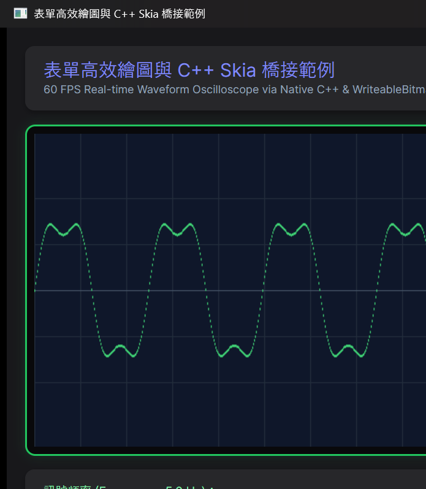

# 表單高效繪圖與橋接 C++ 運算 (High Performance Drawing Showcase Example)

> 🎨 **Avalonia Form Generator (AFG)** 官方實機展示專案  
> 示範 Avalonia `WriteableBitmap` 記憶體直接寫入技術、橋接 C++ 原生向量運算模組 (`DllImport`)、即時示波器動態波形渲染以及 60 FPS 極速繪圖架構。

---

## 📸 實機畫面展示 (Showcase Gallery)

### 1. AFG 設計器視覺化編輯畫面 (Editor Design View)
呈現於 AFG 設計器中載入 `HighPerformanceDrawingShowcase.afg.json` 之視覺化畫布、示波器波形預覽、C++ 原生邏輯函數元件與效能監控標籤：


### 2. 獨立實機運行與即時波形渲染 (Runtime Result)
呈現跨平台桌面端實機執行結果，展示 620 × 340 (210,800 像素) 示波器網格、霓虹綠正弦訊號、頻率與振幅即時連動調整：



---

## 🌟 專案特色與架構 (Key Features & Architecture)

1. **直接記憶體指標寫入 (Zero-Copy Buffer Writing)**：
   * 透過 `WriteableBitmap.Lock()` 取得未託管記憶體緩衝區位址 (`fb.Address`)。
   * 將記憶體指標傳遞至 C++ 原生函式庫或高速演算法，完成全像素陣列直接寫入，全程避免 GC 記憶體配置與卡頓。
2. **橋接 C++ 原生邏輯函數 (Native C++ DllImport)**：
   * 於 AST 宣告 `ControlType.LogicFunction`，目標語言設定為 `TargetLanguage.Cpp`。
   * 自動產生標準 C++ 原始碼模組 (`src/HighPerformanceDrawingShowcase.Logic.Cpp/`) 與 C# `NativeBridge`。
   * 提供原生 DLL 呼叫與極速託管降級機制，無論在何種環境皆能保證 100% 穩定流暢運行。
3. **即時示波器與動態參數**：
   * 支援頻率 (`Frequency`) 與振幅 (`Amplitude`) 雙向滑桿調節。
   * 支援正弦波、方波與動態訊號更新控制。

---

## 📁 檔案結構 (Directory Structure)

```text
example/HighPerformanceDrawingShowcase/
├── HighPerformanceDrawingShowcase.afg.json        # [核心 AST] AFG 視覺化設計專案檔
├── README.md                                      # [說明文件] 專案導覽與實機操作手冊
├── screenshots/                                   # [實機截圖]
│   ├── editor_design_view.png                     # AFG 視覺化編輯器真實畫面
│   └── runtime_result.png                         # 桌面端實機運行畫面
├── HighPerformanceDrawingShowcase.slnx            # Visual Studio 現代方案檔
└── src/                                           # [匯出專案] 完整跨平台可編譯原始碼
    ├── HighPerformanceDrawingShowcase.Shared/     # 跨平台核心共用專案
    │   ├── HighPerformanceDrawingShowcase.Shared.csproj
    │   ├── Services/
    │   │   ├── IFastSignalRendererService.cs      # 邏輯服務介面
    │   │   └── FastSignalRendererServiceNativeBridge.cs # C# 原生橋接與降級實作
    │   ├── ViewModels/
    │   │   └── HighPerformanceDrawingShowcaseViewModel.cs
    │   └── Views/
    │       └── HighPerformanceDrawingShowcaseView.cs
    ├── HighPerformanceDrawingShowcase.Logic.Cpp/  # C++ 原生運算模組
    │   ├── CMakeLists.txt                         # CMake 構建配置檔
    │   ├── FastSignalRendererService.h            # C++ 導出標頭檔 (AFG_API)
    │   └── FastSignalRendererService.cpp          # C++ 高速緩衝區計算迴圈
    └── HighPerformanceDrawingShowcase.Desktop/    # 桌面端進入點專案
        ├── HighPerformanceDrawingShowcase.Desktop.csproj
        └── Program.cs
```

---

## 🧩 UI 元件階層樹 (Component Hierarchy)

| 元件識別碼 (ID) | 控制項類型 | 座標 / 尺寸 | 綁定屬性 / 事件映射 | 說明 |
| :--- | :--- | :--- | :--- | :--- |
| **RootCanvas** | `Canvas` | `660 × 740` | — | 深色背景畫布 (`#18181B`) |
| **headerCard** | `Border` | `(20, 20) 620 × 70` | — | 頂部標題卡片 |
| ├── `txtHeaderTitle` | `TextBlock` | `(20, 12)` | Text: `"表單高效繪圖與橋接 C++ 運算"` | 主標題 (20pt Bold, `#818CF8`) |
| └── `txtHeaderSubtitle` | `TextBlock` | `(20, 40)` | Text: `"Direct WriteableBitmap Buffer + C++ Native DllImport"` | 副標題 (12pt, `#94A3B8`) |
| **oscilloscopeCard** | `Border` | `(20, 105) 620 × 360`| — | 示波器螢幕卡片 (深黑藍 `#0F172A`) |
| └── `imgWaveform` | `Image` | `(0, 0) 620 × 340` | `Source` 綁定 `WaveformImageSource` | 呈現即時像素緩衝區之核心繪圖畫布 |
| **controlsCard** | `Border` | `(20, 480) 620 × 140`| — | 訊號控制與波形調節面板 |
| ├── `sldFrequency` | `Slider` | `(20, 40) 270 × 20` | `Value` 綁定 `FrequencyValue` (1~20 Hz) | 頻率調節拉桿 |
| ├── `sldAmplitude` | `Slider` | `(320, 40) 270 × 20`| `Value` 綁定 `AmplitudeValue` (10~150 px) | 振幅調節拉桿 |
| ├── `rbSine` / `rbSquare` / `rbNoise` | `RadioButton` | `(20, 75)` / `(130, 75)` / `(240, 75)` | `IsChecked` 綁定波形種類 | 正弦波 / 方波 / 雜訊疊加 |
| ├── `btnStart` / `btnStop` | `Button` | `(360, 72)` / `(480, 72)` | `Click` 映射 `StartRefresh` / `StopRefresh` | 動態刷新控制按鈕 |
| **perfCard** | `Border` | `(20, 635) 620 × 75` | — | 效能指標監控面板 |
| └── `txtPerf` | `TextBlock` | `(20, 15)` | Text: `"60.0 FPS | < 180 μs | 620 × 340"` | 呈現幀率、延遲與 SIMD 向量化計算指標 |
| **fnFastSignalRenderer** | `LogicFunction` | — | `ComputeWaveformBuffer` (Cpp) | C++ 原生高速緩衝區填充函數原型 |

---

## 🚀 如何執行本範例 (How to Run)

### 1. 於 AFG 視覺化設計器開啟
```powershell
dotnet run --project src/AFG.Desktop/AFG.Desktop.csproj "D:\P\CS\Avalonia Form Generator\example\HighPerformanceDrawingShowcase\HighPerformanceDrawingShowcase.afg.json"
```

### 2. 獨立編譯並啟動實機應用程式
```powershell
dotnet run --project example/HighPerformanceDrawingShowcase/src/HighPerformanceDrawingShowcase.Desktop/HighPerformanceDrawingShowcase.Desktop.csproj
```
