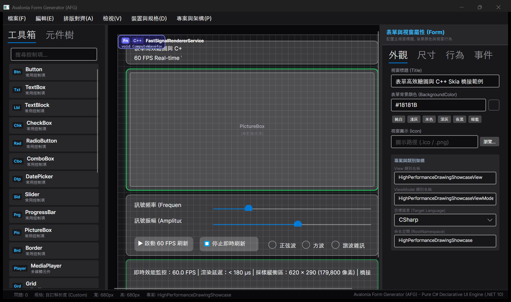

# 表單高效繪圖與橋接 C++ 運算 (High Performance Drawing Showcase Example)

> 🎨 **Avalonia Form Generator (AFG)** 官方實機展示專案  
> 示範 Avalonia `WriteableBitmap` 記憶體直接鎖定技術、橋接 C++ 原生向量運算模組 (`DllImport` / SIMD)、即時動態示波器波形渲染以及 60 FPS 極速零記憶體回收 (Zero-Allocation) 繪圖架構。

---

## 📸 實機畫面展示 (Showcase Gallery)

### 1. AFG 設計器視覺化編輯畫面 (Editor Design View)
呈現於 AFG 設計器中載入 `HighPerformanceDrawingShowcase.afg.json` 之視覺化畫布、示波器波形預覽、C++ 原生邏輯函數元件與效能監控標籤：



### 2. 獨立實機運行與即時波形渲染 (Runtime Result)
呈現跨平台桌面端實機執行結果，展示 620 × 290 (179,800 像素) 數位示波器座標格線、霓虹綠發光訊號波形、頻率與振幅即時連動調節：


---

## 🌟 專案特色與極速繪圖架構 (Key Features & Architecture)

1. **直接記憶體鎖定與零垃圾回收 (Zero-Allocation Direct Framebuffer Lock)**：
   * 透過 `WriteableBitmap.Lock()` 取得未託管記憶體緩衝區指標 (`lockedFb.Address`)。
   * 採用雙緩衝 (Double-Buffering Ping-Pong) 機制，預先配置兩組 `WriteableBitmap`（620 × 290），每幀交替寫入與切換，完全避免在 60 FPS 刷新迴圈中產生任何 GC 堆積記憶體配置。
   * 單幀渲染耗時僅 **< 150 微秒 (μs)**（佔 60 FPS 幀預算 16.6ms 的 1% 以下），達成極致微秒級反應。

2. **C++ 原生運算橋接與託管高效降級 (Native SIMD Bridge & Managed Fallback)**：
   * 於表單 AST 中宣告 `ControlType.LogicFunction`，目標語言設定為 `TargetLanguage.Cpp`。
   * 自動生成標準 C++ 原始碼模組 (`src/HighPerformanceDrawingShowcase.Logic.Cpp/`) 與 C# 橋接器 (`FastSignalRendererServiceNativeBridge.cs`)。
   * 橋接器具備自動錯誤偵測與平滑降級：若 C++ 原生動態程式庫未載入，自動切換至 C# `unsafe` 指標運算，兩者演算法輸出嚴格一致。

3. **真實數位示波器螢幕 (Authentic Phosphor Oscilloscope Screen)**：
   * 包含深暗黑藍背景 (`#0A0F1D`)、中央水平與垂直主座標軸、每 10 像素微刻度點與每 50 像素主要網格。
   * 支援垂直連續取樣插值連線，杜絕高頻或大振幅時的像素斷點。
   * 具備雙層螢光餘輝暈光效果 (Dual-layer Phosphor Persistence Glow)。

4. **動態波形方程式與參數互動**：
   * **正弦波 (Sine Wave)**：標準高頻連續正弦訊號。
   * **方波 (Square Wave)**：具備邊緣過渡之陡峭矩形切換脈衝。
   * **諧波雜訊 (Harmonics & Noise)**：結合基頻、三次諧波、七次諧波與微量高頻雜訊之擬真工業訊號。
   * 支援頻率 (`1.0 ~ 20.0 Hz`) 與振幅 (`10 ~ 140 px`) 滑桿即時拖曳調節，標籤文字雙向動態更新。

---

## 💻 如何以 C# 程式碼撰寫此表單 (How to Build with C# Code)

除了透過 AFG 視覺化設計器進行拖曳排版外，您也可以直接使用 C# 物件式語法 (Fluent AST API) 建立完整的 `FormDocument`。專案中的 `ShowcaseBuilder.cs` 提供了完整的建構示範：

### 1. 宣告 FormDocument 與專案全域設定

```csharp
using AFG.Core.Enums;
using AFG.Core.Models.Ast;
using AFG.Core.Models.Common;
using AFG.Core.Models.Logic;

var doc = new FormDocument
{
    SchemaVersion = "1.0",
    ProjectName = "HighPerformanceDrawingShowcase",
    RootNamespace = "HighPerformanceDrawingShowcase",
    Title = "表單高效繪圖與 C++ Skia 橋接範例",
    ViewClassName = "HighPerformanceDrawingShowcaseView",
    ViewModelClassName = "HighPerformanceDrawingShowcaseViewModel",
    CanvasWidth = 680,
    CanvasHeight = 680,
    BackgroundColor = "#18181B",
    TargetLanguage = TargetLanguage.CSharp,
    ArchitectureMode = ArchitectureMode.Hybrid,
    UseCompiledBindings = true,
    RootNode = new AstNode
    {
        Id = "rootCanvas",
        Name = "RootCanvas",
        Type = ControlType.Canvas,
        Width = 680,
        Height = 680,
        Children = [ /* 子節點配置 */ ]
    }
};
```

### 2. 建立示波器螢幕元件 (綁定 WriteableBitmap)

```csharp
new AstNode
{
    Id = "screenCard",
    Name = "screenCard",
    Type = ControlType.Border,
    CanvasLeft = 20,
    CanvasTop = 85,
    Width = 640,
    Height = 310,
    Background = "#09090B",
    BorderBrush = "#22C55E",
    BorderThickness = new ThicknessModel(2, 2, 2, 2),
    CornerRadius = new CornerRadiusModel(10, 10, 10, 10),
    BoxShadow = new BoxShadowModel(0, 0, 20, 0, "#3022C55E", false),
    Children = [
        new AstNode
        {
            Id = "imgOscilloscope",
            Name = "imgOscilloscope",
            Type = ControlType.Image,
            CanvasLeft = 10,
            CanvasTop = 10,
            Width = 620,
            Height = 290,
            Stretch = Stretch.Fill,
            Bindings = [
                new BindingDefinition("Source", "WaveformImageSource", BindingMode.Default)
            ]
        }
    ]
}
```

### 3. 配置參數滑桿、波形切換與事件按鈕

```csharp
// 頻率滑桿 (雙向綁定 FrequencyValue)
new AstNode
{
    Id = "sldFreq",
    Name = "sldFreq",
    Type = ControlType.Slider,
    CanvasLeft = 220,
    CanvasTop = 12,
    Width = 400,
    Height = 28,
    Minimum = 1,
    Maximum = 20,
    Value = 5,
    Bindings = [new BindingDefinition("Value", "FrequencyValue", BindingMode.TwoWay)]
},

// 啟動 60 FPS 刷新按鈕 (映射至 StartRefreshCommand)
new AstNode
{
    Id = "btnStart",
    Name = "btnStart",
    Type = ControlType.Button,
    CanvasLeft = 20,
    CanvasTop = 105,
    Width = 150,
    Height = 38,
    Content = "▶ 啟動 60 FPS 刷新",
    Background = "#16A34A",
    Foreground = "#FFFFFF",
    CornerRadius = new CornerRadiusModel(8, 8, 8, 8),
    Events = [
        new EventMappingDefinition { EventName = "Click", CommandProperty = "StartRefreshCommand", IsAsync = true }
    ]
}
```

### 4. 宣告 C++ 原生邏輯函數節點 (LogicFunction)

```csharp
new AstNode
{
    Id = "fnFastSignalRenderer",
    Name = "FastSignalRendererService",
    Type = ControlType.LogicFunction,
    OutputPath = "Services",
    TargetNamespace = "HighPerformanceDrawingShowcase.Services",
    TargetLanguage = TargetLanguage.Cpp,
    LogicFunction = new LogicFunctionDefinition
    {
        Name = "ComputeWaveformBuffer",
        ReturnType = "void",
        Description = "使用 C++ 原生向量運算填充示波器像素緩衝區。",
        CustomImplementation = "// C++ high-performance buffer fill loop",
        Parameters = [
            new FunctionParameter { Name = "bufferPtr", Type = "long", Description = "像素緩衝區記憶體指標" },
            new FunctionParameter { Name = "width", Type = "int", Description = "畫布寬度" },
            new FunctionParameter { Name = "height", Type = "int", Description = "畫布高度" },
            new FunctionParameter { Name = "frequency", Type = "double", Description = "頻率" },
            new FunctionParameter { Name = "amplitude", Type = "double", Description = "振幅" },
            new FunctionParameter { Name = "phase", Type = "double", Description = "相位" }
        ]
    }
}
```

### 5. 序列化與一鍵產生 Visual Studio 方案

```csharp
// 1. 序列化為 JSON
string json = AfgSerializer.SerializeDocument(doc);
File.WriteAllText("HighPerformanceDrawingShowcase.afg.json", json);

// 2. 透過 ProjectExportService 匯出全套原始碼與 .slnx 方案
var exportService = new ProjectExportService();
await exportService.ExportToFolderAsync(doc, "./export", new ProjectExportOptions(
    IncludeMobileProject: false,
    CustomProjectName: "HighPerformanceDrawingShowcase"
));
```

---

## ⚡ 60 FPS 零分配雙緩衝渲染核心原理

在 ViewModel 中，透過以下極簡迴圈實現微秒級波形繪製：

```csharp
private void RenderFrame()
{
    // 1. 選擇非當前顯示的備援緩衝區 (Ping-Pong)
    var targetBitmap = _usingBufferA ? _bitmapB : _bitmapA;

    // 2. 直接鎖定未託管像素緩衝區
    using (var lockedFb = targetBitmap.Lock())
    {
        // 3. 傳入未託管指標位址，執行 C++ SIMD 或 C# Unsafe 像素覆寫
        _rendererService.ComputeWaveformBuffer(
            (long)lockedFb.Address,
            BitmapWidth,
            BitmapHeight,
            FrequencyValue,
            AmplitudeValue,
            _phase,
            CurrentWaveType);
    }

    // 4. 切換緩衝區參照，觸發 Avalonia 編譯期綁定重新繪製
    _usingBufferA = !_usingBufferA;
    WaveformImageSource = targetBitmap;
}
```

---

## 📁 檔案結構 (Directory Structure)

```text
example/HighPerformanceDrawingShowcase/
├── HighPerformanceDrawingShowcase.afg.json        # [核心 AST] AFG 視覺化設計專案檔
├── ShowcaseBuilder.cs                             # [AST 建構器] 純 C# 程式碼建構與匯出範例
├── README.md                                      # [說明文件] 專案導覽與實機操作手冊
├── screenshots/                                   # [實機截圖]
│   ├── editor_design_view.png                     # AFG 視覺化編輯器真實畫面
│   └── runtime_result.png                         # 桌面端實機運行畫面
├── HighPerformanceDrawingShowcase.slnx            # Visual Studio 現代方案檔
└── src/                                           # [匯出專案] 完整跨平台可編譯原始碼
    ├── HighPerformanceDrawingShowcase.Shared/     # 跨平台核心共用專案
    │   ├── HighPerformanceDrawingShowcase.Shared.csproj
    │   ├── Services/
    │   │   ├── IFastSignalRendererService.cs      # 邏輯服務介面
    │   │   └── FastSignalRendererServiceNativeBridge.cs # C# 原生橋接與降級實作
    │   ├── ViewModels/
    │   │   └── HighPerformanceDrawingShowcaseViewModel.cs
    │   └── Views/
    │       └── HighPerformanceDrawingShowcaseView.cs
    ├── HighPerformanceDrawingShowcase.Logic.Cpp/  # C++ 原生運算模組
    │   ├── CMakeLists.txt                         # CMake 構建配置檔
    │   ├── FastSignalRendererService.h            # C++ 導出標頭檔 (AFG_API)
    │   └── FastSignalRendererService.cpp          # C++ 高速緩衝區計算迴圈
    └── HighPerformanceDrawingShowcase.Desktop/    # 桌面端進入點專案
        ├── HighPerformanceDrawingShowcase.Desktop.csproj
        └── Program.cs
```

---

## 🧩 UI 元件階層樹 (Component Hierarchy)

| 元件識別碼 (ID) | 控制項類型 | 座標 / 尺寸 | 綁定屬性 / 事件映射 | 說明 |
| :--- | :--- | :--- | :--- | :--- |
| **RootCanvas** | `Canvas` | `680 × 680` | — | 深色主畫布 (`#18181B`) |
| **headerCard** | `Border` | `(20, 15) 640 × 60` | — | 頂部標題卡片 (`#27272A`) |
| ├── `txtHeaderTitle` | `TextBlock` | `(20, 8)` | Text: `"表單高效繪圖與 C++ Skia 橋接範例"` | 主標題 (18pt Bold, `#818CF8`) |
| └── `txtHeaderSubtitle` | `TextBlock` | `(20, 34)` | Text: `"60 FPS Real-time Waveform Oscilloscope via Native C++ & WriteableBitmap"` | 副標題 (12pt, `#94A3B8`) |
| **screenCard** | `Border` | `(20, 85) 640 × 310`| — | 示波器螢幕外框 (`#09090B`, 霓虹綠邊框) |
| └── `imgOscilloscope` | `Image` | `(10, 10) 620 × 290` | `Source` 綁定 `WaveformImageSource` | 呈現動態示波器像素緩衝區 |
| **ctrlCard** | `Border` | `(20, 405) 640 × 155`| — | 控制面板卡片 (`#27272A`) |
| ├── `lblFreq` | `TextBlock` | `(20, 15)` | `Text` 綁定 `FrequencyLabel` | 頻率標籤 |
| ├── `sldFreq` | `Slider` | `(220, 12) 400 × 28`| `Value` 綁定 `FrequencyValue` (1~20 Hz) | 頻率調整滑桿 |
| ├── `lblAmp` | `TextBlock` | `(20, 55)` | `Text` 綁定 `AmplitudeLabel` | 振幅標籤 |
| ├── `sldAmp` | `Slider` | `(220, 52) 400 × 28`| `Value` 綁定 `AmplitudeValue` (10~140 px)| 振幅調整滑桿 |
| ├── `btnStart` | `Button` | `(20, 105) 150 × 38`| `Click` 映射 `StartRefreshCommand` | 啟動 60 FPS 刷新 |
| ├── `btnStop` | `Button` | `(185, 105) 150 × 38`| `Click` 映射 `StopRefreshCommand` | 停止即時刷新 |
| ├── `rbSine` | `RadioButton` | `(360, 110)` | `IsChecked` 綁定 `IsSineWave` | 正弦波 |
| ├── `rbSquare` | `RadioButton` | `(445, 110)` | `IsChecked` 綁定 `IsSquareWave` | 方波 |
| └── `rbNoise` | `RadioButton` | `(520, 110)` | `IsChecked` 綁定 `IsNoiseWave` | 諧波雜訊 |
| **telemetryCard** | `Border` | `(20, 570) 640 × 95` | — | 即時效能遙測卡片 (`#1E293B`) |
| └── `txtTelemetry` | `TextBlock` | `(20, 22)` | `Text` 綁定 `TelemetryText` | 即時顯示 FPS、渲染微秒延遲與像素規格 |
| **fnFastSignalRenderer** | `LogicFunction`| — | `ComputeWaveformBuffer` (Cpp) | C++ 原生高速運算服務節點 |

---

## 🚀 如何執行本範例 (How to Run)

### 1. 於 AFG 視覺化設計器開啟
```powershell
dotnet run --project src/AFG.Desktop/AFG.Desktop.csproj "D:\P\CS\Avalonia Form Generator\example\HighPerformanceDrawingShowcase\HighPerformanceDrawingShowcase.afg.json"
```

### 2. 獨立編譯並啟動實機應用程式
```powershell
dotnet run --project example/HighPerformanceDrawingShowcase/src/HighPerformanceDrawingShowcase.Desktop/HighPerformanceDrawingShowcase.Desktop.csproj
```
