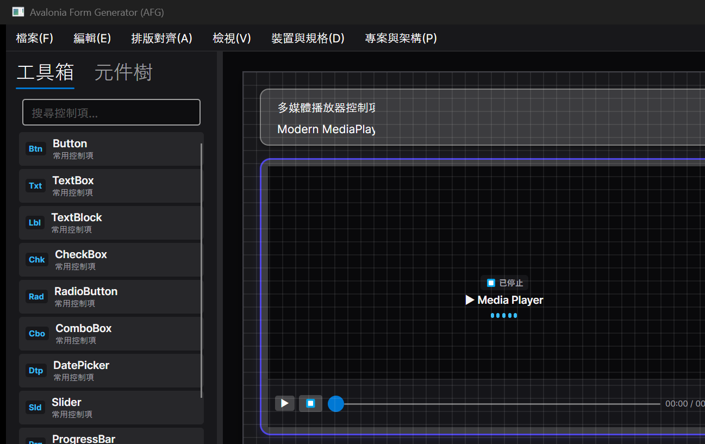

# 多媒體控制項應用 (Media Player Showcase Example)

> 🎨 **Avalonia Form Generator (AFG)** 官方實機展示專案  
> 示範 `MediaPlayerControl` 多媒體控制項之整合、播放傳輸控制 (Play / Pause / Stop)、時間軸與進度拉桿巡覽、音量調整以及播放狀態回饋面板。

---

## 📸 實機畫面展示 (Showcase Gallery)

### 1. AFG 設計器視覺化編輯畫面 (Editor Design View)
呈現於 AFG 設計器中載入 `MediaPlayerShowcase.afg.json` 之視覺化畫布、媒體播放顯示區域與傳輸控制列：



### 2. 獨立實機運行與多媒體播放介面 (Runtime Result)
呈現跨平台桌面端實機執行結果，展示播放時間軸巡覽、傳輸控制按鈕、音量調節拉桿與即時串流狀態指示燈：


---

## 🌟 專案特色與架構 (Key Features & Architecture)

1. **專業多媒體控制項 (MediaPlayerControl)**：AFG 內建支援現代視訊/音訊播放容器，具備硬體解碼適配與自訂渲染能力。
2. **傳輸控制協同 (Transport Controls)**：包含播放 (`PlayCommand`)、暫停 (`PauseCommand`)、停止 (`StopCommand`) 完整生命週期命令。
3. **時間軸與音量雙向綁定**：進度拉桿與音量拉桿皆支援 MVVM 雙向資料綁定，具備直覺的滑動巡覽與循環播放切換 (`IsLooping`)。

---

## 📁 檔案結構 (Directory Structure)

```text
example/MediaPlayerShowcase/
├── MediaPlayerShowcase.afg.json        # [核心 AST] AFG 視覺化設計專案檔
├── README.md                           # [說明文件] 專案導覽與實機操作手冊
├── screenshots/                        # [實機截圖]
│   ├── editor_design_view.png          # AFG 視覺化編輯器真實畫面
│   └── runtime_result.png              # 桌面端實機運行畫面
├── MediaPlayerShowcase.slnx            # Visual Studio 現代方案檔
└── src/                                # [匯出專案] 完整跨平台可編譯原始碼
    ├── MediaPlayerShowcase.Shared/     # 跨平台核心共用專案
    │   ├── MediaPlayerShowcase.Shared.csproj
    │   ├── ViewModels/
    │   │   └── MediaPlayerShowcaseViewModel.cs # 播放控制與狀態管理
    │   └── Views/
    │       └── MediaPlayerShowcaseView.cs      # Fluent C# Markup 介面
    └── MediaPlayerShowcase.Desktop/    # 桌面端進入點專案
        ├── MediaPlayerShowcase.Desktop.csproj
        └── Program.cs
```

---

## 🧩 UI 元件階層樹 (Component Hierarchy)

| 元件識別碼 (ID) | 控制項類型 | 座標 / 尺寸 | 綁定屬性 / 事件映射 | 說明 |
| :--- | :--- | :--- | :--- | :--- |
| **RootCanvas** | `Canvas` | `640 × 720` | — | 深色背景畫布 (`#18181B`) |
| **headerCard** | `Border` | `(20, 20) 600 × 70` | — | 頂部標題卡片 |
| ├── `txtHeaderTitle` | `TextBlock` | `(20, 12)` | Text: `"多媒體播放器控制項展示"` | 主標題 (20pt Bold, `#818CF8`) |
| └── `txtHeaderSubtitle` | `TextBlock` | `(20, 40)` | Text: `"展示 MediaPlayerControl、時間軸巡覽與播放傳輸控制"` | 副標題 (12pt, `#94A3B8`) |
| **playerAreaCard** | `Border` | `(20, 105) 600 × 340`| — | 媒體播放視訊區域 (深黑 `#09090B`) |
| └── `mediaPlayerControl`| `MediaPlayer` | `(0, 0) 600 × 340` | — | 核心多媒體播放容器控制項 |
| **transportCard** | `Border` | `(20, 460) 600 × 165`| — | 播放控制器面板 |
| ├── `txtTrack` | `TextBlock` | `(20, 12)` | Text: `"正在播放：Ambient Synth Wave 2026 (4K 60fps)"` | 曲目與視訊資訊標籤 |
| ├── `sldPosition` | `Slider` | `(20, 42) 560 × 20` | `Value` 雙向綁定 `PositionValue` (0~100) | 時間軸巡覽拉桿 |
| ├── `btnPlay` / `btnPause` / `btnStop` | `Button` | `(20, 80)` / `(110, 80)` / `(200, 80)` | `Click` 映射播放命令 | 播放、暫停與停止控制按鈕 |
| ├── `sldVol` | `Slider` | `(410, 84) 170 × 20`| `Value` 雙向綁定 `VolumeValue` (0~100) | 音量大小調節拉桿 |
| └── `chkLoop` | `CheckBox` | `(20, 126)` | `IsChecked` 雙向綁定 `IsLooping` | 循環播放切換開關 |
| **statusCard** | `Border` | `(20, 640) 600 × 60` | — | 即時音訊格式與狀態卡片 |
| └── `txtStatus` | `TextBlock` | `(20, 20)` | Text: 播放狀態、AAC 48kHz、立體聲 | 呈現即時播放狀態與格式標籤 |

---

## 🚀 如何執行本範例 (How to Run)

### 1. 於 AFG 視覺化設計器開啟
```powershell
dotnet run --project src/AFG.Desktop/AFG.Desktop.csproj "D:\P\CS\Avalonia Form Generator\example\MediaPlayerShowcase\MediaPlayerShowcase.afg.json"
```

### 2. 獨立編譯並啟動實機應用程式
```powershell
dotnet run --project example/MediaPlayerShowcase/src/MediaPlayerShowcase.Desktop/MediaPlayerShowcase.Desktop.csproj
```
