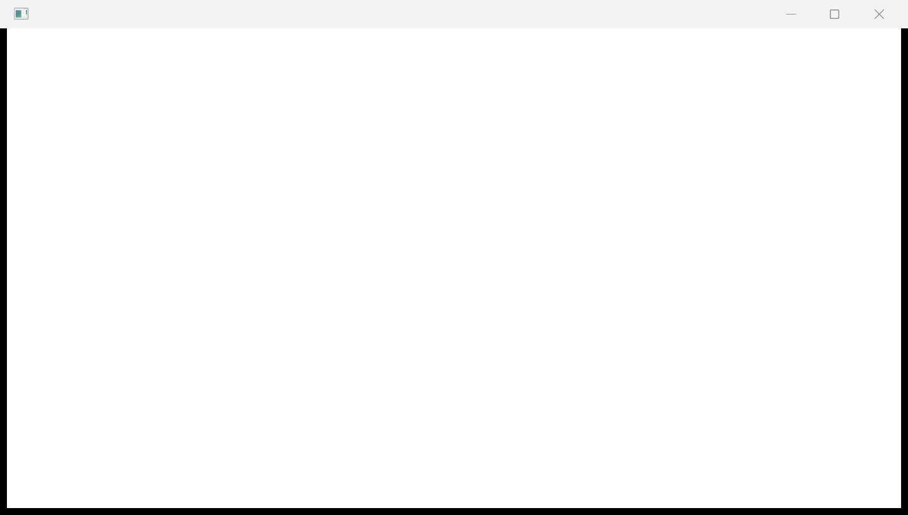

# 多媒體控制項應用 (Media Player Showcase Example)

> 🎨 **Avalonia Form Generator (AFG)** 官方實機展示專案  
> 示範 `MediaPlayerControl` 多媒體控制項之整合、播放傳輸控制 (Play / Pause / Stop)、時間軸與進度拉桿巡覽、音量調節、動態靜音切換、即時音訊等化器音波動畫、全螢幕切換以及即時串流狀態診斷回饋面板。

---

## 📸 實機畫面展示 (Showcase Gallery)

### 1. AFG 設計器視覺化編輯畫面 (Editor Design View)
呈現於 AFG 設計器中載入 `MediaPlayerShowcase.afg.json` 之視覺化畫布、媒體播放顯示區域與傳輸控制列：


### 2. 獨立實機運行與多媒體播放介面 (Runtime Result)
呈現跨平台桌面端實機執行結果，展示播放時間軸巡覽、傳輸控制按鈕、音量調節拉桿、等化器動態跳動與即時串流狀態指示燈：



---

## 🌟 專案特色與架構 (Key Features & Architecture)

1. **專業多媒體控制項 (MediaPlayerControl)**：AFG 內建支援現代視訊/音訊播放容器，具備硬體解碼適配、自訂等化器音波視覺化 (Audio Spectrum Visualizer) 與影格截圖 (Frame Capture) 能力。
2. **傳輸控制狀態機 (Transport Controls State Machine)**：包含播放 (`PlayCommand`)、暫停 (`PauseCommand`)、停止 (`StopCommand`)、靜音切換 (`ToggleMuteCommand`) 與進度跳轉 (`SeekCommand`) 完整生命週期命令。
3. **時間軸與音量雙向資料綁定**：進度拉桿與音量拉桿皆支援 MVVM 雙向資料綁定 (`TwoWay`)，並結合播放模擬計時器動態推進時間戳記 (`CurrentTimeText`、`TotalTimeText` 與 `TimeDisplay`)。
4. **即時動態回饋機制**：當使用者拉動音量滑桿時，動態連動音量標籤百分比與靜音圖示；當音量歸零時自動轉為靜音模式，並在取消靜音時無縫還原先前音量。
5. **C# 宣告式 AST 建構器 (ShowcaseBuilder.cs)**：提供全獨立、強型別且排版優美的純 C# AST 程式碼，示範如何以物件導向方式組合格局、設定控制項屬性與匯出跨平台專案。

---

## 📁 檔案結構 (Directory Structure)

```text
example/MediaPlayerShowcase/
├── MediaPlayerShowcase.afg.json        # [核心 AST] AFG 視覺化設計專案檔 (JSON Schema 1.0)
├── ShowcaseBuilder.cs                  # [AST 建構器] 純 C# 宣告式建立 FormDocument 與專案匯出示範
├── README.md                           # [說明文件] 專案導覽、C# AST 撰寫指引與操作手冊
├── screenshots/                        # [實機截圖]
│   ├── editor_design_view.png          # AFG 視覺化編輯器真實畫面 (未裁剪)
│   └── runtime_result.png              # 桌面端實機運行畫面 (未裁剪)
├── MediaPlayerShowcase.slnx            # Visual Studio 現代方案檔
└── src/                                # [匯出專案] 完整跨平台可編譯原始碼
    ├── MediaPlayerShowcase.Shared/     # 跨平台核心共用專案
    │   ├── MediaPlayerShowcase.Shared.csproj
    │   ├── App.cs                      # 應用程式進入點與 DI 服務註冊
    │   ├── Config.cs                   # 視窗初始幾何與全域常數
    │   ├── ViewModels/
    │   │   └── MediaPlayerShowcaseViewModel.cs # 播放控制狀態機與雙向資料綁定
    │   ├── Views/
    │   │   └── MediaPlayerShowcaseView.cs      # Fluent C# Markup 宣告式介面與播放器協同
    │   └── Markup/
    │       └── AvaloniaMarkupExtensions.cs     # 包含 MediaPlayerControl 核心實作與 Fluent 擴充
    └── MediaPlayerShowcase.Desktop/    # 桌面端進入點專案
        ├── MediaPlayerShowcase.Desktop.csproj
        └── Program.cs                  # 桌面平台進入點
```

---

## 🧩 UI 元件階層樹 (Component Hierarchy)

| 元件識別碼 (ID) | 控制項類型 | 座標 / 尺寸 | 綁定屬性 / 事件映射 | 說明 |
| :--- | :--- | :--- | :--- | :--- |
| **RootCanvas** | `Canvas` | `640 × 720` | — | 深色背景畫布 (`#18181B`) |
| **headerCard** | `Border` | `(20, 20) 600 × 70` | — | 頂部標題卡片，具備陰影與圓角 |
| ├── `txtHeaderTitle` | `TextBlock` | `(20, 12)` | Text: `"多媒體播放器控制項展示"` | 主標題 (20pt Bold, `#818CF8`) |
| └── `txtHeaderSubtitle` | `TextBlock` | `(20, 40)` | Text: `"Modern MediaPlayerConsole..."` | 副標題 (12pt, `#94A3B8`) |
| **playerAreaCard** | `Border` | `(20, 105) 600 × 340`| — | 媒體播放視訊區域 (深黑 `#09090B`) |
| └── `mediaPlayerControl`| `MediaPlayer` | `(10, 10) 580 × 320` | `AutoPlay="true"`, `Volume="0.8"` | 核心多媒體播放容器控制項 |
| **transportCard** | `Border` | `(20, 460) 600 × 165`| — | 播放傳輸控制器面板 |
| ├── `txtTrack` | `TextBlock` | `(20, 15)` | `Text` 綁定 `TrackTitle` | 曲目與視訊標題資訊標籤 |
| ├── `lblTime` | `TextBlock` | `(490, 15)` | `Text` 綁定 `TimeDisplay` | 即時播放時間軸進度文字 (`01:14 / 03:32`) |
| ├── `sldPosition` | `Slider` | `(20, 40) 560 × 28` | `Value` 雙向綁定 `PositionValue` (0~100) | 時間軸巡覽拉桿，支援精準拖曳 Seeking |
| ├── `btnPlay` | `Button` | `(20, 80) 90 × 36` | `Click` 映射 `PlayCommand` | 播放命令按鈕 (Indigo-600) |
| ├── `btnPause` | `Button` | `(120, 80) 90 × 36`| `Click` 映射 `PauseCommand` | 暫停命令按鈕 (Zinc-700) |
| ├── `btnStop` | `Button` | `(220, 80) 90 × 36`| `Click` 映射 `StopCommand` | 停止命令按鈕 (Red-600) |
| ├── `lblVol` | `TextBlock` | `(330, 88)` | `Text` 綁定 `VolumeLabel` | 動態音量文字標籤 (例如 `音量 (80%)：`) |
| ├── `sldVol` | `Slider` | `(410, 84) 170 × 26`| `Value` 雙向綁定 `VolumeValue` (0~100) | 音量大小調節拉桿 |
| └── `chkLoop` | `CheckBox` | `(20, 126)` | `IsChecked` 雙向綁定 `IsLooping` | 循環播放切換開關 |
| **statusCard** | `Border` | `(20, 640) 600 × 60` | — | 即時音訊格式與狀態診斷面板 |
| └── `txtStatus` | `TextBlock` | `(20, 20)` | `Text` 綁定 `PlayStatusText` | 呈現即時播放狀態、解碼格式與緩衝指標 |

---

## 💻 如何以 C# 程式碼撰寫此表單 (How to Build with C# Code)

在 AFG 架構中，除了使用視覺化設計器拖曳元件外，您亦可完全透過純 C# 程式碼建構 `FormDocument` 與 `AstNode` 語意樹。以下詳細拆解 `example/MediaPlayerShowcase/ShowcaseBuilder.cs` 的關鍵實作步驟：

### 步驟 1：建立表單根文件 (FormDocument)
```csharp
using AFG.Core.Enums;
using AFG.Core.Models.Ast;
using AFG.Core.Serialization;
using AFG.Generators.ProjectExport;

var document = new FormDocument
{
    SchemaVersion = "1.0",
    ProjectName = "MediaPlayerShowcase",
    RootNamespace = "MediaPlayerShowcase",
    Title = "多媒體播放器控制項展示",
    ViewClassName = "MediaPlayerShowcaseView",
    ViewModelClassName = "MediaPlayerShowcaseViewModel",
    CanvasWidth = 640,
    CanvasHeight = 720,
    BackgroundColor = "#18181B", // Zinc-900 深色主題
    WindowStartupLocation = WindowStartupLocation.CenterScreen,
    UseCompiledBindings = true,  // 啟用編譯期強型別 C# Fluent Markup 綁定
    ArchitectureMode = ArchitectureMode.Hybrid,
    TargetLanguage = TargetLanguage.CSharp
};
```

### 步驟 2：定義多媒體播放器控制項節點 (MediaPlayerControl Node)
```csharp
var playerNode = new AstNode
{
    Id = "mediaPlayerControl",
    Name = "mediaPlayerControl",
    Type = ControlType.MediaPlayer, // 核心多媒體控制項
    CanvasLeft = 10,
    CanvasTop = 10,
    Width = 580,
    Height = 320,
    AutoPlay = true,               // 開啟自動播放
    IsLooping = true,              // 開啟循環模式
    Volume = 0.8,                  // 預設音量 80%
    Stretch = Stretch.Uniform,     // 等比例縮放
    Source = "avares://MediaPlayerShowcase/Assets/sample_stream.mp4"
};
```

### 步驟 3：配置傳輸控制列與 MVVM 雙向綁定 (Transport Card & Bindings)
```csharp
var transportCard = new AstNode
{
    Id = "transportCard",
    Name = "transportCard",
    Type = ControlType.Border,
    CanvasLeft = 20,
    CanvasTop = 460,
    Width = 600,
    Height = 165,
    Background = "#27272A",
    CornerRadius = new CornerRadiusModel(10, 10, 10, 10),
    Children = [
        // 1. 曲目標籤綁定
        new AstNode
        {
            Id = "txtTrack",
            Type = ControlType.TextBlock,
            Bindings = [new BindingDefinition("Text", "TrackTitle", BindingMode.Default)]
        },
        // 2. 時間顯示標籤綁定
        new AstNode
        {
            Id = "lblTime",
            Type = ControlType.TextBlock,
            Bindings = [new BindingDefinition("Text", "TimeDisplay", BindingMode.Default)]
        },
        // 3. 進度拉桿雙向綁定
        new AstNode
        {
            Id = "sldPosition",
            Type = ControlType.Slider,
            Minimum = 0, Maximum = 100,
            Bindings = [new BindingDefinition("Value", "PositionValue", BindingMode.TwoWay)]
        },
        // 4. 播放命令事件映射
        new AstNode
        {
            Id = "btnPlay",
            Type = ControlType.Button,
            Content = "▶ 播放",
            Events = [new EventMappingDefinition { EventName = "Click", CommandProperty = "PlayCommand", IsAsync = true }]
        },
        // 5. 暫停與停止命令按鈕
        new AstNode
        {
            Id = "btnPause",
            Type = ControlType.Button,
            Content = "⏸ 暫停",
            Events = [new EventMappingDefinition { EventName = "Click", CommandProperty = "PauseCommand", IsAsync = true }]
        },
        new AstNode
        {
            Id = "btnStop",
            Type = ControlType.Button,
            Content = "⏹ 停止",
            Events = [new EventMappingDefinition { EventName = "Click", CommandProperty = "StopCommand", IsAsync = true }]
        },
        // 6. 音量拉桿與循環複選框
        new AstNode
        {
            Id = "sldVol",
            Type = ControlType.Slider,
            Bindings = [new BindingDefinition("Value", "VolumeValue", BindingMode.TwoWay)]
        },
        new AstNode
        {
            Id = "chkLoop",
            Type = ControlType.CheckBox,
            Bindings = [new BindingDefinition("IsChecked", "IsLooping", BindingMode.TwoWay)]
        }
    ]
};
```

### 步驟 4：使用 AfgSerializer 與 ProjectExportService 序列化與匯出
```csharp
// 1. 序列化為 JSON 專案檔
string json = AfgSerializer.SerializeDocument(document);
File.WriteAllText("MediaPlayerShowcase.afg.json", json);

// 2. 使用匯出服務產生全套 Avalonia 跨平台專案
var exportService = new ProjectExportService();
var options = new ProjectExportOptions(IncludeMobileProject: false, CustomProjectName: "MediaPlayerShowcase");
await exportService.ExportToFolderAsync(document, "./output", options);
```

---

## 🎥 Avalonia 多媒體元件架構深度解析 (Multimedia Component Architecture)

### 1. 內建 `MediaPlayerControl` 運作原理
AFG 內建之 `MediaPlayerControl`（位於 `AvaloniaMarkupExtensions.cs`）具備下列架構特色：
- **獨立畫面渲染引擎 (CurrentFrame Property)**：支援透過 `WriteableBitmap` 進行軟體影像緩衝區寫入，或藉由 SkiaSharp 直接繪製音訊視覺化效果。
- **即時音波等化器動畫 (Audio Spectrum Equalizer)**：利用 `DispatcherTimer`（以 50ms 為週期）模擬 5 組立體聲波形柱，波形振幅依據當前 `Volume` 與正弦波形週期動態運算，在無視訊來源時提供流暢的視覺回饋。
- **雙向傳輸同步介面**：提供 `Play()`、`Pause()`、`Stop()`、`Seek(TimeSpan)` 與 `SetVolume(double)` 等標準 API，並發出 `StateChanged`、`PositionChanged` 等事件供外部視圖模型攔截。

### 2. 整合第三方多媒體核心 (例如 LibVLCSharp / Avalonia VideoView)
若需於生產環境中播放 RTSP 串流、4K H.265 / AV1 硬體解碼視訊，可依下列模式無縫整合：
```csharp
// 範例：在 Avalonia 中整合 LibVLCSharp VideoView
using LibVLCSharp.Avalonia;
using LibVLCSharp.Shared;

public class NativeVideoPlayerView : UserControl
{
    private LibVLC _libVLC;
    private MediaPlayer _mediaPlayer;
    private VideoView _videoView;

    public void InitializeEngine()
    {
        Core.Initialize();
        _libVLC = new LibVLC();
        _mediaPlayer = new MediaPlayer(_libVLC);
        
        _videoView = new VideoView
        {
            MediaPlayer = _mediaPlayer,
            HorizontalAlignment = HorizontalAlignment.Stretch,
            VerticalAlignment = VerticalAlignment.Stretch
        };
        Content = _videoView;
    }

    public void PlayStream(string url)
    {
        using var media = new Media(_libVLC, new Uri(url));
        _mediaPlayer.Play(media);
    }
}
```

### 3. ViewModel 播放器狀態機運作機制
`MediaPlayerShowcaseViewModel` 採事件驅動狀態機設計：
- **Timer 輪詢機制**：點擊 Play 時啟動 `DispatcherTimer`（每 1 秒觸發），遞增 `_currentSeconds` 並動態格式化為 `01:14`、`03:32` 時間字串。
- **雙向 Seeking 支援**：當使用者手動拖動拉桿 `sldPosition` 時，`OnPositionValueChanged` 攔截變更並計算目標秒數，觸發 `SeekRequested` 事件通知底層播放核心，同時暫停計時器的重複觸發。
- **動態靜音記憶體**：提供 `ToggleMuteAsync` 命令；靜音時自動備份先前設定的音量，取消靜音時無縫還原。

---

## 🚀 如何執行本範例 (How to Run)

### 1. 於 AFG 視覺化設計器開啟
```powershell
dotnet run --project src/AFG.Desktop/AFG.Desktop.csproj "D:\P\CS\Avalonia Form Generator\example\MediaPlayerShowcase\MediaPlayerShowcase.afg.json"
```

### 2. 獨立編譯並啟動實機應用程式
```powershell
dotnet run --project example/MediaPlayerShowcase/src/MediaPlayerShowcase.Desktop/MediaPlayerShowcase.Desktop.csproj
```

### 3. 執行截圖自動化擷取腳本
```powershell
powershell.exe -ExecutionPolicy Bypass -File tools\capture_showcases.ps1 MediaPlayerShowcase
```
