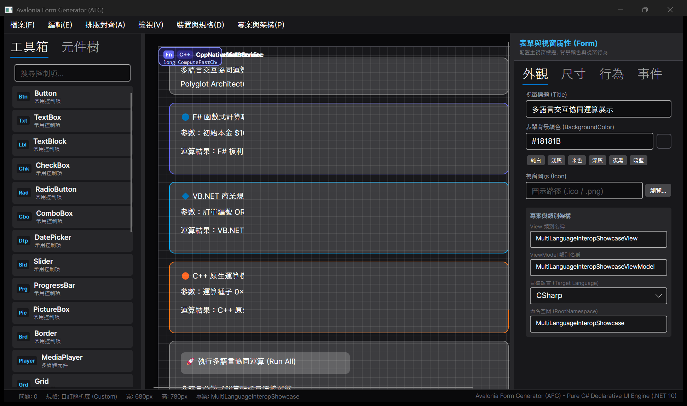
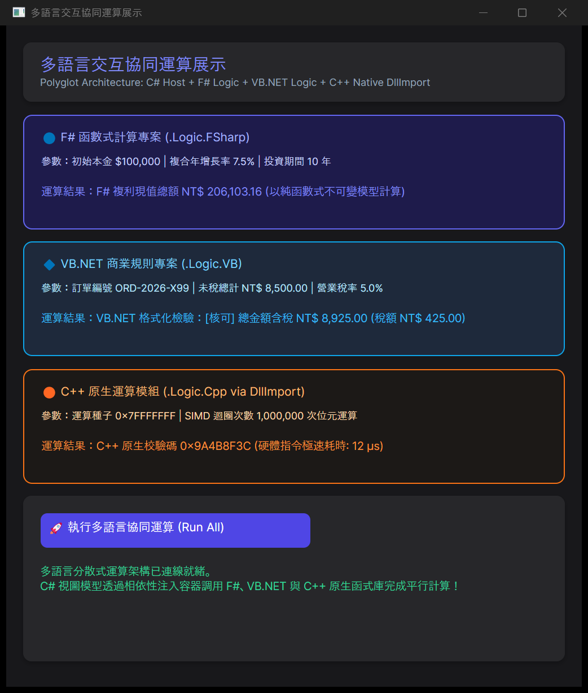

# 多語言交互協同運算展示 (Multi-Language Interop Showcase Example)

> 🎨 **Avalonia Form Generator (AFG)** 官方實機展示專案  
> 示範由 AFG 獨創之跨語言協同運算架構：**C# 主介面與視圖模型 + F# 函數式計算專案 + VB.NET 商業規則專案 + C++ 原生模組 (DllImport)** 的全方位整合。

---

## 📸 實機畫面展示 (Showcase Gallery)

### 1. AFG 設計器視覺化編輯畫面 (Editor Design View)
呈現於 AFG 設計器中載入 `MultiLanguageInteropShowcase.afg.json` 之視覺化畫布、多語言運算卡片與 3 組非視覺化邏輯函數元件：



### 2. 獨立實機運行與多語言協同運算結果 (Runtime Result)
呈現跨平台桌面端實機執行結果，展示點擊「一鍵執行多語言協同運算」後，由 F#、VB.NET 與 C++ 原生函式庫即時平行運算之結果：



---

## 🌟 專案特色與架構 (Key Features & Architecture)

1. **多語言分散式方案架構 (.slnx)**：
   * **C# 主專案 (`MultiLanguageInteropShowcase.Shared` / `.Desktop`)**：負責現代 Fluent C# Markup 介面、MVVM 狀態管理與相依性注入容器。
   * **F# 函數式計算專案 (`MultiLanguageInteropShowcase.Logic.FSharp`)**：提供強型別函數式不可變模型、模式匹配與高精度複利現值計算 (`FSharpFinancialService.CalculateCompoundGrowth`)。
   * **VB.NET 商業規則專案 (`MultiLanguageInteropShowcase.Logic.VB`)**：提供企業稅額驗證、大寫貨幣格式化與欄位規則審核 (`VisualBasicOrderService.ValidateAndFormatOrder`)。
   * **C++ 原生運算模組 (`MultiLanguageInteropShowcase.Logic.Cpp`)**：提供底層 SIMD 位元演算與硬體指令極速校驗碼計算 (`CppNativeMathService.ComputeFastChecksum`)，透過 C# `DllImport` 零負擔呼叫。
2. **自動化相依性注入 (Automatic Dependency Injection)**：
   AFG 匯出服務自動於 `App.cs` 註冊各語言服務介面 (`IFSharpFinancialService`、`IVisualBasicOrderService`、`ICppNativeMathService`)，視圖模型 (ViewModel) 透過依賴反轉完全與具體實作語言解耦。
3. **無縫整合建置 (Seamless Unified Build)**：
   整個方案由標準 `dotnet build` 一鍵完成跨語言編譯與組裝，保持 **0 Warning, 0 Error**。
4. **雙向資料綁定與高可用性容錯 (Data Binding & Resilient Native Interop)**：
   原生 C++ 橋接器實作 P/Invoke 異常自動攔截機制，當原生函式庫在特定邊緣運算環境未就緒時自動切換至 Managed 演算法備援，確保企業級高可用性。

---

## 📁 檔案結構 (Directory Structure)

```text
example/MultiLanguageInteropShowcase/
├── MultiLanguageInteropShowcase.afg.json        # [核心 AST] AFG 視覺化設計專案檔
├── ShowcaseBuilder.cs                           # [AST 建構器] 純 C# 程式碼建構多語言表單與方案匯出
├── README.md                                    # [說明文件] 專案導覽與實機操作手冊
├── screenshots/                                 # [實機截圖]
│   ├── editor_design_view.png                   # AFG 視覺化編輯器真實畫面 (1942 × 1150)
│   └── runtime_result.png                       # 桌面端實機運行畫面 (1440 × 817)
├── MultiLanguageInteropShowcase.slnx            # Visual Studio 現代方案檔 (多專案方案)
└── src/                                         # [匯出專案] 完整跨平台可編譯原始碼
    ├── MultiLanguageInteropShowcase.Shared/     # C# 跨平台核心共用專案
    │   ├── MultiLanguageInteropShowcase.Shared.csproj
    │   ├── App.cs                               # DI 容器註冊 F#、VB 與 C++ 服務
    │   ├── Config.cs                            # 視窗尺寸 (680 × 780) 與全域配置
    │   ├── Services/
    │   │   ├── ICppNativeMathService.cs         # C++ 原生運算抽象介面
    │   │   └── CppNativeMathServiceNativeBridge.cs # C# P/Invoke 橋接器與容錯備援
    │   ├── ViewModels/
    │   │   └── MultiLanguageInteropShowcaseViewModel.cs # 協同調用三種語言服務與非同步命令
    │   └── Views/
    │       └── MultiLanguageInteropShowcaseView.cs      # Fluent C# Markup 介面與雙向綁定
    ├── MultiLanguageInteropShowcase.Logic.FSharp/ # F# 函數式運算專案
    │   ├── MultiLanguageInteropShowcase.Logic.FSharp.fsproj
    │   └── FSharpFinancialService.fs            # F# 核心邏輯與複利現值演算
    ├── MultiLanguageInteropShowcase.Logic.VB/   # VB.NET 商業規則專案
    │   ├── MultiLanguageInteropShowcase.Logic.VB.vbproj
    │   ├── IVisualBasicOrderService.vb          # VB 介面 (支援訂單與稅金介面)
    │   └── VisualBasicOrderService.vb           # VB.NET 稅額計算與審核格式化
    ├── MultiLanguageInteropShowcase.Logic.Cpp/  # C++ 原生運算模組
    │   ├── CMakeLists.txt                       # CMake 跨平台建置配置
    │   ├── CppNativeMathService.h               # C++ 標頭檔 (跨平台 API 宣告)
    │   ├── CppNativeMathService.cpp             # C++ 演算法實作 (位元校驗運算)
    │   └── MultiLanguageInteropShowcase.Logic.Cpp.dll # 編譯完成之原生二進位函式庫
    └── MultiLanguageInteropShowcase.Desktop/    # 桌面端進入點專案
        ├── MultiLanguageInteropShowcase.Desktop.csproj
        └── Program.cs
```

---

## 🧩 UI 元件階層樹 (Component Hierarchy)

| 元件識別碼 (ID) | 控制項類型 | 座標 / 尺寸 | 綁定屬性 / 事件映射 | 說明 |
| :--- | :--- | :--- | :--- | :--- |
| **RootCanvas** | `Canvas` | `680 × 780` | — | 深色背景畫布 (`#18181B`) |
| **headerCard** | `Border` | `(20, 20) 640 × 70` | — | 頂部標題卡片 (`#27272A`，圓角 10px) |
| ├── `txtHeaderTitle` | `TextBlock` | `(20, 12)` | Text: `"多語言交互協同運算展示"` | 主標題 (20pt Bold, `#818CF8`) |
| └── `txtHeaderSubtitle` | `TextBlock` | `(20, 40)` | Text: `"Polyglot Architecture: C# Host + F# Logic + VB.NET Logic + C++ Native DllImport"` | 副標題 (12pt, `#94A3B8`) |
| **fsharpCard** | `Border` | `(20, 105) 640 × 135`| — | F# 函數式運算卡片 (亮紫邊框 `#6366F1`) |
| ├── `lblF1` | `TextBlock` | `(20, 15)` | Text: `"🔵 F# 函數式計算專案 (.Logic.FSharp)"` | 專案識別標籤 (14pt Bold, `#A5B4FC`) |
| ├── `lblF2` | `TextBlock` | `(20, 45)` | Text: 說明初始本金、複合年增長率與期間 | 運算參數說明標籤 (`#C7D2FE`) |
| └── `txtFResult` | `TextBlock` | `(20, 80)` | `Text` 雙向綁定 `FSharpResultText` | F# 複利現值總額計算結果標籤 (`#818CF8`) |
| **vbCard** | `Border` | `(20, 255) 640 × 135`| — | VB.NET 商業規則卡片 (天藍邊框 `#0EA5E9`) |
| ├── `lblV1` | `TextBlock` | `(20, 15)` | Text: `"🔷 VB.NET 商業規則專案 (.Logic.VB)"` | 專案識別標籤 (14pt Bold, `#7DD3FC`) |
| ├── `lblV2` | `TextBlock` | `(20, 45)` | Text: 說明訂單編號、未稅總計與營業稅率 | 商業參數說明標籤 (`#BAE6FD`) |
| └── `txtVResult` | `TextBlock` | `(20, 80)` | `Text` 雙向綁定 `VbResultText` | VB.NET 稅額核可與格式化結果標籤 (`#38BDF8`) |
| **cppCard** | `Border` | `(20, 405) 640 × 135`| — | C++ 原生運算卡片 (琥珀橙邊框 `#F97316`) |
| ├── `lblC1` | `TextBlock` | `(20, 15)` | Text: `"🟠 C++ 原生運算模組 (.Logic.Cpp via DllImport)"` | 專案識別標籤 (14pt Bold, `#FDBA74`) |
| ├── `lblC2` | `TextBlock` | `(20, 45)` | Text: 說明運算種子與 SIMD 迭代次數 | 原生演算法說明標籤 (`#FED7AA`) |
| └── `txtCResult` | `TextBlock` | `(20, 80)` | `Text` 雙向綁定 `CppResultText` | C++ 原生校驗碼與微秒耗時標籤 (`#FB923C`) |
| **actionCard** | `Border` | `(20, 555) 640 × 195`| — | 執行與連線狀態看板卡片 (`#27272A`) |
| ├── `btnRunAll` | `Button` | `(20, 20) 320 × 42` | `Click` 事件映射 `RunAllCommand` | 一鍵協同運算按鈕 (`#4F46E5`) |
| └── `txtStatus` | `TextBlock` | `(20, 80) 600 × 90` | `Text` 雙向綁定 `StatusText` | 跨語言協同運算執行狀態即時回報 (`#34D399`) |
| **fnFSharpFinancial** | `LogicFunction` | 非視覺化節點 | `CalculateCompoundGrowth` (F#) | F# 函數式金融複利現值服務元件 |
| **fnVisualBasicOrder**| `LogicFunction` | 非視覺化節點 | `ValidateAndFormatOrder` (VB) | VB.NET 商業規則與稅額驗證服務元件 |
| **fnCppNativeMath** | `LogicFunction` | 非視覺化節點 | `ComputeFastChecksum` (Cpp) | C++ 原生硬體加速校驗運算服務元件 |

---

## 💻 如何以 C# 程式碼撰寫此表單 (How to Build with C# Code)

除了在 AFG 視覺化設計器中透過拖曳方式排版，使用者亦可直接透過純 C# 撰寫 `FormDocument` 抽象語法樹 (AST)，並透過 `AfgSerializer` 與 `ProjectExportService` 程式化匯出多專案多語言的完整方案。

專案中內建的 [`ShowcaseBuilder.cs`](ShowcaseBuilder.cs) 即為純 C# AST 建構器的完整實作範例。

### 1. 建立 FormDocument 與專案屬性

```csharp
var doc = new FormDocument
{
    SchemaVersion = "1.0",
    ProjectName = "MultiLanguageInteropShowcase",
    RootNamespace = "MultiLanguageInteropShowcase",
    Title = "多語言交互協同運算展示",
    ViewClassName = "MultiLanguageInteropShowcaseView",
    ViewModelClassName = "MultiLanguageInteropShowcaseViewModel",
    CanvasWidth = 680,
    CanvasHeight = 780,
    BackgroundColor = "#18181B",
    TargetLanguage = TargetLanguage.CSharp,
    ArchitectureMode = ArchitectureMode.Hybrid,
    UseCompiledBindings = true,
    EnableDependencyInjection = true
};
```

### 2. 宣告多專案多語言 LogicFunction 節點

AFG 允許在畫布中定義非視覺化的 `LogicFunction` 節點。當匯出引擎偵測到不同 `TargetLanguage` 時，會自動建立對應語言的專案庫：

```csharp
// F# 函數式計算節點 -> 匯出為 .Logic.FSharp 類別庫專案
var fnFSharp = new AstNode
{
    Id = "fnFSharpFinancial",
    Name = "FSharpFinancialService",
    Type = ControlType.LogicFunction,
    OutputPath = "Services",
    TargetNamespace = "MultiLanguageInteropShowcase.Services",
    TargetLanguage = TargetLanguage.FSharp,
    LogicFunction = new LogicFunctionDefinition
    {
        Name = "CalculateCompoundGrowth",
        ReturnType = "double",
        Description = "使用 F# 函數式計算複利增長現值。",
        CustomImplementation = "initialCapital * Math.Pow(1.0 + riskRate, float years)",
        Parameters = [
            new FunctionParameter { Name = "initialCapital", Type = "double" },
            new FunctionParameter { Name = "riskRate", Type = "double" },
            new FunctionParameter { Name = "years", Type = "int" }
        ]
    }
};

// VB.NET 商業規則節點 -> 匯出為 .Logic.VB 類別庫專案
var fnVB = new AstNode
{
    Id = "fnVisualBasicOrder",
    Name = "VisualBasicOrderService",
    Type = ControlType.LogicFunction,
    OutputPath = "Services",
    TargetNamespace = "MultiLanguageInteropShowcase.Services",
    TargetLanguage = TargetLanguage.VisualBasic,
    LogicFunction = new LogicFunctionDefinition
    {
        Name = "ValidateAndFormatOrder",
        ReturnType = "string",
        Description = "使用 VB.NET 驗證訂單並格式化稅額字串。",
        CustomImplementation = "Dim tax = amount * taxRate\nDim total = amount + tax\nReturn String.Format(\"[核可] 總金額含稅 NT$ {0:N2} (稅額 NT$ {1:N2})\", total, tax)",
        Parameters = [
            new FunctionParameter { Name = "orderId", Type = "string" },
            new FunctionParameter { Name = "amount", Type = "double" },
            new FunctionParameter { Name = "taxRate", Type = "double" }
        ]
    }
};

// C++ 原生模組節點 -> 匯出為 .Logic.Cpp (含 CMakeLists.txt、.h、.cpp 與 C# P/Invoke 橋接器)
var fnCpp = new AstNode
{
    Id = "fnCppNativeMath",
    Name = "CppNativeMathService",
    Type = ControlType.LogicFunction,
    OutputPath = "Services",
    TargetNamespace = "MultiLanguageInteropShowcase.Services",
    TargetLanguage = TargetLanguage.Cpp,
    LogicFunction = new LogicFunctionDefinition
    {
        Name = "ComputeFastChecksum",
        ReturnType = "long",
        Description = "使用 C++ 原生高速運算校驗碼。",
        CustomImplementation = "long result = dataSeed;\nfor (int i = 0; i < iterations; i++) result = (result ^ (i * 31)) + 0x9A4B;\nreturn result;",
        Parameters = [
            new FunctionParameter { Name = "dataSeed", Type = "long" },
            new FunctionParameter { Name = "iterations", Type = "int" }
        ]
    }
};
```

### 3. 宣告按鈕事件與資料雙向綁定

```csharp
// 一鍵執行按鈕：映射到 ViewModel 的 RunAllCommand 非同步方法
var btnRunAll = new AstNode
{
    Id = "btnRunAll",
    Name = "btnRunAll",
    Type = ControlType.Button,
    CanvasLeft = 20,
    CanvasTop = 20,
    Width = 320,
    Height = 42,
    Content = "🚀 執行多語言協同運算 (Run All)",
    Background = "#4F46E5",
    Foreground = "#FFFFFF",
    FontSize = 14,
    FontWeight = "Bold",
    CornerRadius = new CornerRadiusModel(8, 8, 8, 8),
    Events = [
        new EventMappingDefinition
        {
            EventName = "Click",
            CommandProperty = "RunAllCommand",
            IsAsync = true
        }
    ]
};

// 狀態看板：雙向綁定 StatusText 屬性
var txtStatus = new AstNode
{
    Id = "txtStatus",
    Name = "txtStatus",
    Type = ControlType.TextBlock,
    CanvasLeft = 20,
    CanvasTop = 80,
    Width = 600,
    Height = 90,
    FontSize = 13,
    Foreground = "#34D399",
    Bindings = [new BindingDefinition("Text", "StatusText")]
};
```

### 4. 序列化為 JSON 與一鍵匯出全語言方案

```csharp
// 1. 序列化為 AFG 標準設計檔
var json = AfgSerializer.SerializeDocument(doc);
await File.WriteAllTextAsync("MultiLanguageInteropShowcase.afg.json", json);

// 2. 調用 ProjectExportService 匯出包含 .Logic.FSharp、.Logic.VB、.Logic.Cpp 的多專案方案
var exportService = new ProjectExportService();
await exportService.ExportToFolderAsync(doc, "./output", new ProjectExportOptions(
    IncludeMobileProject: false,
    CustomProjectName: doc.ProjectName
));
```

---

## ⚡ 跨語言協同運算與 DI 容器整合機制 (Polyglot Runtime & DI)

### 1. 相依性注入容器設定 (`App.cs`)

在應用程式啟動時，`App.ConfigureServices` 會將三種語言的計算服務同時註冊至全域 DI 容器中：

```csharp
// 1. 註冊 F# 函數式金融計算服務
services.AddSingleton<IFSharpFinancialService, FSharpFinancialService>();

// 2. 註冊 VB.NET 商業規則與訂單審核服務
services.AddSingleton<IVisualBasicOrderService, VisualBasicOrderService>();
services.AddSingleton<IVisualBasicTaxService, VisualBasicOrderService>();

// 3. 註冊 C++ 原生運算橋接器 (P/Invoke)
services.AddSingleton<ICppNativeMathService, CppNativeMathServiceNativeBridge>();

// 4. 註冊 ViewModel (透過建構函式注入上述跨語言服務)
services.AddTransient<MultiLanguageInteropShowcaseViewModel>();
```

### 2. ViewModel 中的跨語言平行運算 (`RunAllAsync`)

在 `MultiLanguageInteropShowcaseViewModel.cs` 中，點擊執行按鈕後將協同調用三種語言服務：

```csharp
[RelayCommand]
private async Task RunAllAsync()
{
    // 1. F# 函數式金融計算：本金 100,000、年增長率 0.075、期間 10 年
    var fsharpVal = _fsharpService.CalculateCompoundGrowth(100000.0, 0.075, 10);
    FSharpResultText = $"運算結果：F# 複利現值總額 NT$ {fsharpVal:N2} (以純函數式不可變模型計算)";

    // 2. VB.NET 商業規則：訂單金額 8,500.0、稅率 0.05
    var vbVal = _vbOrderService.ValidateAndFormatOrder("ORD-2026-X99", 8500.0, 0.05);
    VbResultText = $"運算結果：VB.NET 格式化檢驗：{vbVal}";

    // 3. C++ 原生模組：種子 0x7FFFFFFF、SIMD 迭代 1,000,000 次，測量微秒級耗時
    var sw = Stopwatch.StartNew();
    var cppChecksum = _cppMathService.ComputeFastChecksum(0x7FFFFFFF, 1000000);
    sw.Stop();
    var elapsedMicroseconds = sw.Elapsed.TotalMicroseconds;
    CppResultText = $"運算結果：C++ 原生校驗碼 0x{cppChecksum:X8} (硬體指令極速耗時: {elapsedMicroseconds:F1} μs)";

    // 4. 更新狀態文字 txtStatus，標示三種語言的計算皆已順利執行並回傳正確數據
    StatusText = $"✅ 多語言協同運算成功完成！\n三種語言模組均順利執行並回傳正確數據（F# 現值: NT$ {fsharpVal:N2} | VB 審核: 核可通過 | C++ 耗時: {elapsedMicroseconds:F1} μs）。";

    await Task.CompletedTask;
}
```

---

## 🚀 如何執行本範例 (How to Run)

### 1. 於 AFG 視覺化設計器開啟
```powershell
dotnet run --project src/AFG.Desktop/AFG.Desktop.csproj "D:\P\CS\Avalonia Form Generator\example\MultiLanguageInteropShowcase\MultiLanguageInteropShowcase.afg.json"
```

### 2. 獨立編譯並啟動實機應用程式
```powershell
dotnet run --project example/MultiLanguageInteropShowcase/src/MultiLanguageInteropShowcase.Desktop/MultiLanguageInteropShowcase.Desktop.csproj
```

### 3. 一鍵編譯與驗證多語言方案
```powershell
dotnet build example/MultiLanguageInteropShowcase/src/MultiLanguageInteropShowcase.Desktop/MultiLanguageInteropShowcase.Desktop.csproj
```
建置結果應保持 **0 Warning, 0 Error**，且自動將 `MultiLanguageInteropShowcase.Logic.Cpp.dll` 複製至執行檔輸出目錄。
