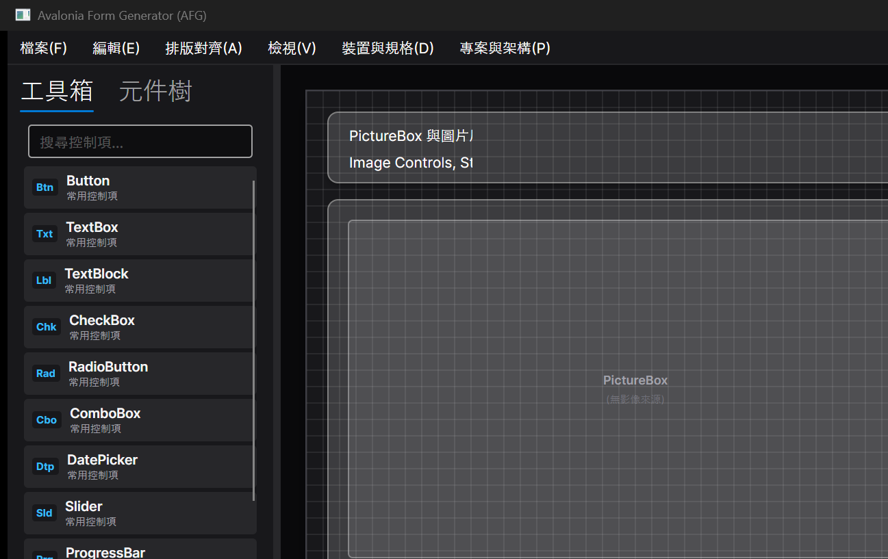

# PictureBox 圖片展示與縮放模式 (PictureBox Showcase Example)

> 🎨 **Avalonia Form Generator (AFG)** 官方實機展示專案  
> 示範 `PictureBox` 控制項之影像資料來源綁定、動態光譜測試卡生成、以及 4 種核心縮放模式 (`Stretch.Uniform`, `Stretch.UniformToFill`, `Stretch.Fill`, `Stretch.None`) 的即時切換。

---

## 📸 實機畫面展示 (Showcase Gallery)

### 1. AFG 設計器視覺化編輯畫面 (Editor Design View)
呈現於 AFG 設計器中載入 `PictureBoxShowcase.afg.json` 之視覺化畫布、圖片展示視窗與控制按鈕面板：



### 2. 獨立實機運行與圖片渲染結果 (Runtime Result)
呈現桌面端實機渲染結果，展示 600 × 400 高對比棋盤光譜測試圖以及影像資訊標籤：


---

## 🌟 專案特色與架構 (Key Features & Architecture)

1. **高彈性縮放模式切換**：
   * `Stretch.Uniform`：維持原始長寬比等比縮放，確保完整內容呈現不失真。
   * `Stretch.UniformToFill`：維持長寬比填滿容器，超出部分等比裁切。
   * `Stretch.Fill`：非等比強制拉伸至容器尺寸。
   * `Stretch.None`：以原始解析度 (1:1 像素) 置中渲染。
2. **動態記憶體點陣圖 (WriteableBitmap)**：ViewModel 示範直接透過記憶體陣列填充生成測試影像，免除外部檔案載入延遲。
3. **優雅容器包覆**：利用深色邊框卡片、柔和陰影與圓角裁切，呈現具現代質感的相片畫廊風格。

---

## 📁 檔案結構 (Directory Structure)

```text
example/PictureBoxShowcase/
├── PictureBoxShowcase.afg.json        # [核心 AST] AFG 視覺化設計專案檔
├── README.md                          # [說明文件] 專案導覽與實機操作手冊
├── screenshots/                       # [實機截圖]
│   ├── editor_design_view.png         # AFG 視覺化編輯器真實畫面
│   └── runtime_result.png             # 桌面端實機運行畫面
├── PictureBoxShowcase.slnx            # Visual Studio 現代方案檔
└── src/                               # [匯出專案] 完整跨平台可編譯原始碼
    ├── PictureBoxShowcase.Shared/     # 跨平台核心共用專案
    │   ├── PictureBoxShowcase.Shared.csproj
    │   ├── ViewModels/
    │   │   └── PictureBoxShowcaseViewModel.cs # 影像來源生成與切換
    │   └── Views/
    │       └── PictureBoxShowcaseView.cs      # Fluent C# Markup 介面
    └── PictureBoxShowcase.Desktop/    # 桌面端進入點專案
        ├── PictureBoxShowcase.Desktop.csproj
        └── Program.cs
```

---

## 🧩 UI 元件階層樹 (Component Hierarchy)

| 元件識別碼 (ID) | 控制項類型 | 座標 / 尺寸 | 綁定屬性 / 事件映射 | 說明 |
| :--- | :--- | :--- | :--- | :--- |
| **RootCanvas** | `Canvas` | `640 × 680` | — | 深色背景畫布 (`#18181B`) |
| **headerCard** | `Border` | `(20, 20) 600 × 70` | — | 頂部標題卡片 |
| ├── `txtHeaderTitle` | `TextBlock` | `(20, 12)` | Text: `"PictureBox 圖片展示與縮放模式"` | 主標題 (20pt Bold, `#818CF8`) |
| └── `txtHeaderSubtitle` | `TextBlock` | `(20, 40)` | Text: `"展示 PictureBox 控制項與動態 Stretch 縮放模式"` | 副標題 (12pt, `#94A3B8`) |
| **imageDisplayCard** | `Border` | `(20, 105) 600 × 360`| — | 影像展示主要區域 |
| └── `picMain` | `PictureBox` | `(10, 10) 580 × 340`| `Source` 綁定 `ImageSource` | 核心圖片顯示控制項 (深色背景 `#0F172A`) |
| **controlsCard** | `Border` | `(20, 480) 600 × 90` | — | 縮放模式與範例切換控制面板 |
| ├── `rbUniform` / `rbUniformToFill` | `RadioButton` | `(20, 45)` / `(110, 45)` | `IsChecked` 綁定縮放模式 | 等比縮放適配 / 等比填滿裁切 |
| ├── `rbFill` / `rbNone` | `RadioButton` | `(240, 45)` / `(310, 45)` | `IsChecked` 綁定縮放模式 | 非等比拉伸 / 原始尺寸置中 |
| ├── `btnLoadA` | `Button` | `(400, 40) 85 × 32` | `Click` 映射 `LoadSampleACommand` | 載入靛藍棋盤測試圖 |
| └── `btnLoadB` | `Button` | `(495, 40) 85 × 32` | `Click` 映射 `LoadSampleBCommand` | 載入金橘高對比測試圖 |
| **infoCard** | `Border` | `(20, 585) 600 × 70` | — | 圖片中繼資料與狀態卡片 |
| └── `txtImageInfo` | `TextBlock` | `(20, 25)` | `Text` 單向綁定 `ImageInfoText` | 呈現尺寸、長寬比與縮放模式資訊 |

---

## 🚀 如何執行本範例 (How to Run)

### 1. 於 AFG 視覺化設計器開啟
```powershell
dotnet run --project src/AFG.Desktop/AFG.Desktop.csproj "D:\P\CS\Avalonia Form Generator\example\PictureBoxShowcase\PictureBoxShowcase.afg.json"
```

### 2. 獨立編譯並啟動實機應用程式
```powershell
dotnet run --project example/PictureBoxShowcase/src/PictureBoxShowcase.Desktop/PictureBoxShowcase.Desktop.csproj
```
