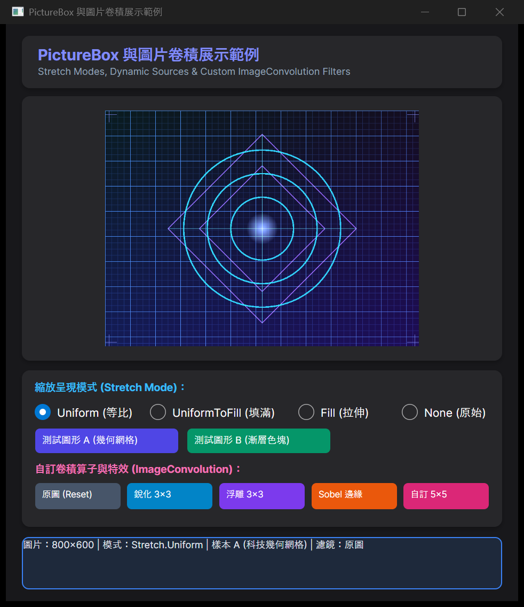

# PictureBox 圖片展示與縮放模式 (PictureBox Showcase Example)

> 🎨 **Avalonia Form Generator (AFG)** 官方實機展示專案  
> 示範 `PictureBox` 控制項之影像資料來源綁定、動態幾何網格與同心光譜生成、4 種核心縮放模式 (`Stretch.Uniform`, `Stretch.UniformToFill`, `Stretch.Fill`, `Stretch.None`) 的即時雙向切換，以及獨立 SIMD 卷積引擎 (`ImageConvolution` + `ConvolutionKernel` + `IConvolutionPostProcessor`) 之即時濾鏡操作。

---

## 📸 實機畫面展示 (Showcase Gallery)

### 1. AFG 設計器視覺化編輯畫面 (Editor Design View)
呈現於 AFG 設計器中載入 `PictureBoxShowcase.afg.json` 之視覺化畫布、圖片展示視窗與控制按鈕面板：


### 2. 獨立實機運行與圖片渲染結果 (Runtime Result)
呈現桌面端實機渲染結果，展示高科技藍紫幾何網格測試圖以及即時影像資訊中繼標籤：



---

## 🌟 專案特色與架構 (Key Features & Architecture)

1. **高彈性縮放模式切換 (Stretch Modes)**：
   * `Stretch.Uniform`：維持原始長寬比等比縮放，確保完整內容呈現且不失真（兩側適當留黑）。
   * `Stretch.UniformToFill`：維持長寬比填滿容器，超出視野部分等比裁切。
   * `Stretch.Fill`：非等比強制拉伸至視窗容器尺寸。
   * `Stretch.None`：以原始解析度 (1:1 像素) 置中渲染，超越畫布部分自然裁剪。
2. **動態記憶體點陣圖 (WriteableBitmap)**：ViewModel 示範直接透過記憶體陣列指標填充高對比測試影像，免除外部檔案 I/O 與資源載入延遲，兼顧極致效能與跨平台穩定度。
3. **雙向 MVVM 模式聯動**：單選按鈕 (RadioButton) 變更時，透過 CommunityToolkit.Mvvm 即時驅動 `StretchMode` 屬性與中繼文字標籤 (`ImageInfoText`) 更新。
4. **現代化深色卡片視覺**：採用深色介面色彩 (`#18181B`)、高質感圓角卡片邊框 (`CornerRadius="10"`) 與柔和立體陰影 (`BoxShadow`)。

---

## 📁 檔案結構 (Directory Structure)

```text
example/PictureBoxShowcase/
├── PictureBoxShowcase.afg.json        # [核心 AST] AFG 視覺化設計專案檔 (JSON 規格)
├── ShowcaseBuilder.cs                 # [AST 建構器] 純 C# 宣告式建構 AST 與方案生成示範
├── README.md                          # [說明文件] 專案導覽、AST 程式碼指南與操作手冊
├── screenshots/                       # [實機截圖]
│   ├── editor_design_view.png         # AFG 視覺化編輯器真實畫面 (全視窗未裁剪)
│   └── runtime_result.png             # 桌面端實機運行畫面 (真實視窗渲染)
├── PictureBoxShowcase.slnx            # Visual Studio 現代方案檔
└── src/                               # [匯出專案] 完整跨平台可編譯原始碼
    ├── PictureBoxShowcase.Shared/     # 跨平台核心共用專案
    │   ├── PictureBoxShowcase.Shared.csproj
    │   ├── Helpers/
    │   │   └── ImageConvolution.cs            # 獨立 SIMD 影像卷積算子與執行引擎
    │   ├── ViewModels/
    │   │   └── PictureBoxShowcaseViewModel.cs # WriteableBitmap 生成與即時卷積濾鏡邏輯
    │   ├── Views/
    │   │   └── PictureBoxShowcaseView.cs      # Fluent C# Markup 宣告式介面
    │   └── Markup/
    │       └── AvaloniaMarkupExtensions.cs    # AFG Fluent Markup 擴充方法庫
    └── PictureBoxShowcase.Desktop/    # 桌面端進入點專案
        ├── PictureBoxShowcase.Desktop.csproj
        └── Program.cs                 # 桌面平台進入點
```

---

## 🧩 UI 元件階層樹 (Component Hierarchy)

| 元件識別碼 (ID) | 控制項類型 | 座標 / 尺寸 | 綁定屬性 / 事件映射 | 說明 |
| :--- | :--- | :--- | :--- | :--- |
| **RootCanvas** | `Canvas` | `640 × 720` | — | 深色背景畫布 (`#18181B`) |
| **headerCard** | `Border` | `(20, 15) 600 × 65` | — | 頂部標題卡片，具備立體陰影與圓角 |
| ├── `txtHeaderTitle` | `TextBlock` | `(20, 10)` | Text: `"PictureBox 與圖片卷積展示範例"` | 主標題 (19pt Bold, `#818CF8`) |
| └── `txtHeaderSubtitle` | `TextBlock` | `(20, 37)` | Text: `"Stretch Modes, Dynamic Sources & Custom ImageConvolution Filters"` | 副標題 (12pt, `#94A3B8`) |
| **viewerCard** | `Border` | `(20, 90) 600 × 330` | — | 影像展示主要區域卡片 |
| └── `imgDisplay` | `PictureBox` | `(20, 18) 560 × 294` | `Source` 綁定 `ImageSource`<br/>`Stretch` 綁定 `StretchMode` | 核心圖片顯示控制項，動態支援 4 種縮放模式 |
| **controlCard** | `Border` | `(20, 432) 600 × 195` | — | 縮放模式、樣本切換與自訂卷積控制面板 |
| ├── `lblStretchTitle` | `TextBlock` | `(16, 12)` | Text: `"縮放呈現模式 (Stretch Mode)："` | 區塊標題 (13pt Bold, `#38BDF8`) |
| ├── `rbUniform` | `RadioButton` | `(16, 36)` | `IsChecked` 雙向綁定 `IsUniformStretch` | 等比適配模式 (Uniform) |
| ├── `rbUniformToFill` | `RadioButton` | `(160, 36)` | `IsChecked` 雙向綁定 `IsUniformToFillStretch` | 等比填滿模式 (UniformToFill) |
| ├── `rbFill` | `RadioButton` | `(345, 36)` | `IsChecked` 雙向綁定 `IsFillStretch` | 非等比拉伸模式 (Fill) |
| ├── `rbNone` | `RadioButton` | `(475, 36)` | `IsChecked` 雙向綁定 `IsNoneStretch` | 原始解析度置中模式 (None) |
| ├── `btnSampleA` | `Button` | `(16, 72) 180 × 32` | `Click` 映射 `LoadSampleACommand` | 載入科技幾何網格 (800 × 600) |
| ├── `btnSampleB` | `Button` | `(206, 72) 180 × 32` | `Click` 映射 `LoadSampleBCommand` | 載入同心光環光譜 (1024 × 768) |
| ├── `lblConvTitle` | `TextBlock` | `(16, 114)` | Text: `"自訂卷積算子與特效 (ImageConvolution)："` | 卷積控制區塊標題 (13pt Bold, `#F472B6`) |
| ├── `btnConvReset` | `Button` | `(16, 140) 108 × 34` | `Click` 映射 `ResetFilterCommand` | 還原未經濾鏡處理的原始影像 |
| ├── `btnConvSharpen` | `Button` | `(131, 140) 108 × 34` | `Click` 映射 `ApplySharpenCommand` | 套用內建 3×3 銳化卷積 (`ConvolutionKernel.Sharpen`) |
| ├── `btnConvEmboss` | `Button` | `(246, 140) 108 × 34` | `Click` 映射 `ApplyEmbossCommand` | 套用浮雕算子 (`ConvolutionKernel.Emboss`) |
| ├── `btnConvSobel` | `Button` | `(361, 140) 108 × 34` | `Click` 映射 `ApplySobelCommand` | RGB 雙核梯度邊緣偵測 (`ConvolutionKernel.Sobel`) |
| └── `btnConvCustom` | `Button` | `(476, 140) 108 × 34` | `Click` 映射 `ApplyCustomKernelCommand` | 套用使用者自訂 5×5 卷積核與結構後處理器 |
| **infoCard** | `Border` | `(20, 640) 600 × 65` | — | 圖片中繼資料與濾鏡耗時反饋卡片 |
| └── `txtImageInfo` | `TextBlock` | `(20, 22)` | `Text` 單向綁定 `ImageInfoText` | 呈現尺寸、長寬比、模式與樣本資訊 |

---

## 💻 如何以 C# 程式碼撰寫此表單 (How to Build with C# Code)

在 AFG 生態系中，除了可以使用圖形化設計器視覺化拖曳元件外，您也可以利用純 C# 程式碼透過宣告式物件模型直接建構 AST 語意樹。

詳見獨立建構器檔案 [`ShowcaseBuilder.cs`](ShowcaseBuilder.cs)，其逐步架構解析如下：

### 1. 定義 FormDocument 根文件
設定視窗標題、視窗大小 (640 × 720)、啟動位置及生成架構模式：
```csharp
var document = new FormDocument
{
    SchemaVersion = "1.0",
    ProjectName = "PictureBoxShowcase",
    RootNamespace = "PictureBoxShowcase",
    ViewClassName = "PictureBoxShowcaseView",
    ViewModelClassName = "PictureBoxShowcaseViewModel",
    Title = "PictureBox 與圖片展示範例",
    BackgroundColor = "#18181B",
    CanvasWidth = 640,
    CanvasHeight = 720,
    WindowStartupLocation = WindowStartupLocation.CenterScreen,
    ArchitectureMode = ArchitectureMode.Hybrid,
    TargetLanguage = TargetLanguage.CSharp,
    RootNode = rootCanvas
};
```

### 2. 建立 PictureBox / Image 圖片展示節點與 MVVM 綁定
建立 `AstNode` 並指定 `Type = ControlType.PictureBox`，設定尺寸與預設縮放模式，並宣告 `Source` 與 `Stretch` 的 MVVM 資料綁定：
```csharp
var imgDisplay = new AstNode
{
    Id = "imgDisplay",
    Name = "imgDisplay",
    Type = ControlType.PictureBox,
    Width = 560,
    Height = 330,
    CanvasLeft = 20,
    CanvasTop = 20,
    Stretch = Stretch.Uniform,
    Bindings =
    [
        // 綁定影像來源 (Avalonia.Media.IImage)
        new BindingDefinition
        {
            TargetProperty = "Source",
            ViewModelProperty = "ImageSource",
            Mode = BindingModeType.Default
        },
        // 綁定縮放模式 (Avalonia.Media.Stretch)
        new BindingDefinition
        {
            TargetProperty = "Stretch",
            ViewModelProperty = "StretchMode",
            Mode = BindingModeType.Default
        }
    ]
};
```

### 3. 配置 RadioButton、Button 與 TextBlock 控制項
使用 `BindingDefinition` 實現單選按鈕雙向聯動，並使用 `EventMappingDefinition` 將按鈕點擊事件對應至非同步命令：
```csharp
// 單選按鈕：雙向綁定至 ViewModel.IsUniformStretch
var rbUniform = new AstNode
{
    Id = "rbUniform",
    Name = "rbUniform",
    Type = ControlType.RadioButton,
    CanvasLeft = 20,
    CanvasTop = 42,
    Content = "Uniform (等比適配)",
    IsChecked = true,
    Bindings =
    [
        new BindingDefinition
        {
            TargetProperty = "IsChecked",
            ViewModelProperty = "IsUniformStretch",
            Mode = BindingModeType.TwoWay
        }
    ]
};

// 樣本載入按鈕：映射至 LoadSampleACommand 非同步命令
var btnSampleA = new AstNode
{
    Id = "btnSampleA",
    Name = "btnSampleA",
    Type = ControlType.Button,
    Width = 180,
    Height = 34,
    CanvasLeft = 20,
    CanvasTop = 80,
    Content = "測試圖形 A (幾何網格)",
    Background = "#4F46E5",
    Foreground = "#FFFFFF",
    Events =
    [
        new EventMappingDefinition
        {
            EventName = "Click",
            CommandProperty = "LoadSampleACommand",
            IsAsync = true
        }
    ]
};
```

### 4. 透過 AfgSerializer 序列化與 ProjectExportService 匯出專案
```csharp
// 1. 將 FormDocument 序列化為官方標準 JSON 規格檔
string json = AfgSerializer.SerializeDocument(document);
File.WriteAllText("PictureBoxShowcase.afg.json", json);

// 2. 調用 ProjectExportService 匯出包含 .Shared 與 .Desktop 的完整方案
var exportService = new ProjectExportService();
var files = exportService.GenerateFullProject(document, new ProjectExportOptions
{
    IncludeMobileProject = false,
    IncludeLicense = false
});
```

---

## 🎨 在 Avalonia 中使用 WriteableBitmap 動態產生與綁定點陣圖

在高效能桌面影像應用中，頻繁從磁碟讀取或解碼外部圖檔會產生大量記憶體分配與 I/O 延遲。Avalonia 提供的 `WriteableBitmap` 允許直接操作底層記憶體緩衝區 (Pixel Buffer)，實現極速繪製與動態影像生成。

### 1. 建立記憶體點陣圖與鎖定緩衝區
透過 `Bgra8888` 像素格式與 `Premul` Alpha 混合模式建立點陣圖，並透過 `wb.Lock()` 取得記憶體基底指標與跨距 (Stride)：
```csharp
var wb = new WriteableBitmap(
    new PixelSize(width, height),
    new Avalonia.Vector(96, 96),
    PixelFormat.Bgra8888,
    AlphaFormat.Premul);

using var fb = wb.Lock();
unsafe
{
    byte* basePtr = (byte*)fb.Address;
    int stride = fb.RowBytes;

    for (int y = 0; y < height; y++)
    {
        uint* row = (uint*)(basePtr + y * stride);
        for (int x = 0; x < width; x++)
        {
            // BGRA8888 格式寫入 (Little Endian: B, G, R, A)
            row[x] = (uint)((alpha << 24) | (red << 16) | (green << 8) | blue);
        }
    }
}
```

### 2. 測試圖樣演算法特色
* **樣本 A (科技幾何網格 - 800 × 600)**：
  - 藍紫色幾何雙向漸層底色 (`#0A0D1E` 至 `#1E1B4B`)。
  - 雙重科技網格系統 (16px 次網格與 64px 主網格)。
  - 核心同心校準環 (半徑 80, 140, 200px) 與菱形曼哈頓導引框。
  - 垂直與水平穿透十字準心及周圍定位角標。
* **樣本 B (同心光環光譜 - 1024 × 768)**：
  - 依據角度與半徑動態計算的 HSV 彩虹連續色相環。
  - 高頻同心正弦波光環 (`sin(dist * 0.08)`) 與 16 道放射狀光芒。
  - 核心白色高光聚集與邊緣漸暈暗角 (Vignette) 效果。

### 3. MVVM 屬性綁定與獨立卷積引擎 (`ImageConvolution`)
在 ViewModel 中除了將生成的 `WriteableBitmap` 賦值予 `[ObservableProperty] private Avalonia.Media.IImage? _imageSource;`，亦可直接使用 `Helpers/ImageConvolution.cs` 所提供的獨立 SIMD 卷積引擎套用內建或使用者自訂算子與零開銷結構後處理器：

```csharp
// 1. 定義使用者自訂 5×5 卷積核與零開銷泛型後處理器
private static readonly ConvolutionKernel s_custom5x5Kernel = ConvolutionKernel.Create2D(
    new float[,]
    {
        {  0f,  0f, -1f,  0f,  0f },
        {  0f, -1f, -2f, -1f,  0f },
        { -1f, -2f, 21f, -2f, -1f },
        {  0f, -1f, -2f, -1f,  0f },
        {  0f,  0f, -1f,  0f,  0f }
    },
    factor: 1.0f / 5.0f,
    name: "自訂 5×5 超銳化");

private readonly struct ContrastBoostPostProcessor(float gain) : IConvolutionPostProcessor
{
    public void PostProcess(int x, int y, ref float b, ref float g, ref float r, ref float a)
    {
        b = (b - 128f) * gain + 128f;
        g = (g - 128f) * gain + 128f;
        r = (r - 128f) * gain + 128f;
    }
}

// 2. 以非破壞性方式從原始點陣圖生成濾鏡結果 (或使用 ApplyConvolution 原地修改)
WriteableBitmap filtered = _sourceBitmap.Convolve(s_custom5x5Kernel, new ContrastBoostPostProcessor(1.18f));
WriteableBitmap sobelRgb = _sourceBitmap.Convolve(
    ConvolutionKernel.Sobel,
    new ConvolutionOptions(GradientChannelMode: GradientChannelMode.PerChannelRgb, GradientThreshold: 12.0f));
```

---

## 🚀 如何執行本範例 (How to Run)

### 1. 於 AFG 視覺化設計器開啟
```powershell
dotnet run --project src/AFG.Desktop/AFG.Desktop.csproj "D:\P\CS\Avalonia Form Generator\example\PictureBoxShowcase\PictureBoxShowcase.afg.json"
```

### 2. 獨立編譯並啟動實機應用程式
```powershell
dotnet run --project example/PictureBoxShowcase/src/PictureBoxShowcase.Desktop/PictureBoxShowcase.Desktop.csproj
```
