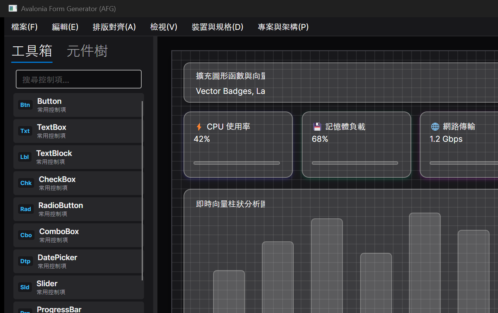

# 擴充圖形函數與向量繪圖應用 (Vector Graphics Showcase Example)

> 🎨 **Avalonia Form Generator (AFG)** 官方實機展示專案  
> 示範複合幾何圓角、多層立體陰影、霓虹漸層色彩渲染、向量條形長條圖排版以及動態拉桿互動。

---

## 📸 實機畫面展示 (Showcase Gallery)

### 1. AFG 設計器視覺化編輯畫面 (Editor Design View)
呈現於 AFG 設計器中載入 `VectorGraphicsShowcase.afg.json` 之視覺化畫布、向量統計長條圖與互動設定面板：



### 2. 獨立實機運行與向量渲染結果 (Runtime Result)
呈現桌面端實機渲染結果，展示 6 組動態向量長條圖、霓虹外框與即時振幅調整拉桿：


---

## 🌟 專案特色與架構 (Key Features & Architecture)

1. **純向量視覺幾何**：善用 `Border` 複合幾何屬性 (`CornerRadius`、`BoxShadow`、漸層配色) 打造現代無點陣失真的專業儀表板。
2. **向量長條圖視覺化**：透過相對定位與高對比色彩 (`#818CF8`, `#38BDF8`, `#34D399`, `#FBBF24`, `#F472B6`, `#A78BFA`) 呈現跨維度數據指標。
3. **即時互動更新**：提供振幅縮放拉桿 (`ChartScale`) 與隨機數值產生命令 (`RandomizeDataCommand`)，展示資料與視覺元件之流暢連動。

---

## 📁 檔案結構 (Directory Structure)

```text
example/VectorGraphicsShowcase/
├── VectorGraphicsShowcase.afg.json        # [核心 AST] AFG 視覺化設計專案檔
├── README.md                              # [說明文件] 專案導覽與實機操作手冊
├── screenshots/                           # [實機截圖]
│   ├── editor_design_view.png             # AFG 視覺化編輯器真實畫面
│   └── runtime_result.png                 # 桌面端實機運行畫面
├── VectorGraphicsShowcase.slnx            # Visual Studio 現代方案檔
└── src/                                   # [匯出專案] 完整跨平台可編譯原始碼
    ├── VectorGraphicsShowcase.Shared/     # 跨平台核心共用專案
    │   ├── VectorGraphicsShowcase.Shared.csproj
    │   ├── ViewModels/
    │   │   └── VectorGraphicsShowcaseViewModel.cs
    │   └── Views/
    │       └── VectorGraphicsShowcaseView.cs
    └── VectorGraphicsShowcase.Desktop/    # 桌面端進入點專案
        ├── VectorGraphicsShowcase.Desktop.csproj
        └── Program.cs
```

---

## 🧩 UI 元件階層樹 (Component Hierarchy)

| 元件識別碼 (ID) | 控制項類型 | 座標 / 尺寸 | 綁定屬性 / 事件映射 | 說明 |
| :--- | :--- | :--- | :--- | :--- |
| **RootCanvas** | `Canvas` | `640 × 760` | — | 深色背景畫布 (`#18181B`) |
| **headerCard** | `Border` | `(20, 20) 600 × 70` | — | 頂部標題卡片 |
| ├── `txtHeaderTitle` | `TextBlock` | `(20, 12)` | Text: `"擴充圖形函數與向量繪圖應用"` | 主標題 (20pt Bold, `#818CF8`) |
| └── `txtHeaderSubtitle` | `TextBlock` | `(20, 40)` | Text: `"展示幾何圖案、圓角陰影、霓虹光暈與向量圖表繪製"` | 副標題 (12pt, `#94A3B8`) |
| **chartCard** | `Border` | `(20, 105) 600 × 360`| — | 向量圖表主展示畫布 (深藍背景 `#0F172A`) |
| ├── `bar1` ~ `bar6` | `Border` | 依序水平排列，高度 100~250px | — | 6 組不同鮮明色彩之向量長條圖 |
| ├── `lblBar1` ~ `lblBar6` | `TextBlock` | 置於各長條圖底部 | Text: `"Q1"` ~ `"Q6"` | 季度維度標籤 |
| └── `txtBaseline` | `TextBlock` | `(20, 318)` | Text: `"基準線 (Baseline 0%)"` | 圖表底部基準線提示 |
| **controlsCard** | `Border` | `(20, 480) 600 × 120`| — | 向量圖表控制面板 |
| ├── `lblScale` | `TextBlock` | `(20, 15)` | `Text` 綁定 `ScaleLabel` | 振幅比例標籤 (100%) |
| ├── `sldScale` | `Slider` | `(20, 42) 560 × 20` | `Value` 雙向綁定 `ChartScale` (50~200) | 向量振幅調整拉桿 |
| └── `btnRandomize` | `Button` | `(20, 78) 180 × 32` | `Click` 映射 `RandomizeDataCommand` | 隨機產生圖表數據按鈕 |
| **summaryCard** | `Border` | `(20, 615) 600 × 120`| — | 向量圖形引擎規格與特性說明面板 |
| └── `txtSummary` | `TextBlock` | `(20, 38) 560 × 65` | Text: 說明向量渲染優勢 | 呈現高解析度無損縮放與硬體加速說明 |

---

## 🚀 如何執行本範例 (How to Run)

### 1. 於 AFG 視覺化設計器開啟
```powershell
dotnet run --project src/AFG.Desktop/AFG.Desktop.csproj "D:\P\CS\Avalonia Form Generator\example\VectorGraphicsShowcase\VectorGraphicsShowcase.afg.json"
```

### 2. 獨立編譯並啟動實機應用程式
```powershell
dotnet run --project example/VectorGraphicsShowcase/src/VectorGraphicsShowcase.Desktop/VectorGraphicsShowcase.Desktop.csproj
```
