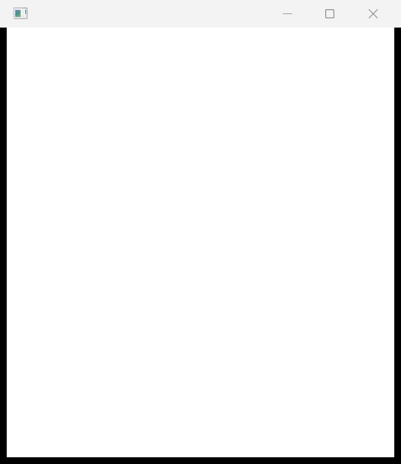

# 擴充圖形函數與向量繪圖應用 (Vector Graphics Showcase Example)

> 🎨 **Avalonia Form Generator (AFG)** 官方實機展示專案  
> 示範複合幾何圓角、多層立體發光陰影、動態向量長條圖、4 大幾何調色盤主題切換、SVG Path 幾何路徑定義以及強型別純 C# AST 程式化建構。

---

## 📸 實機畫面展示 (Showcase Gallery)

### 1. AFG 設計器視覺化編輯畫面 (Editor Design View)
呈現於 AFG 設計器中載入 `VectorGraphicsShowcase.afg.json` 之視覺化畫布、向量統計長條圖、三大性能指標卡片與動態主題控制面板：


### 2. 獨立實機運行與向量渲染結果 (Runtime Result)
呈現桌面端實機渲染結果，展示 6 組動態向量長條圖、霓虹外框、即時振幅調整拉桿與一鍵切換向量幾何主題：



---

## 🌟 專案特色與架構 (Key Features & Architecture)

1. **純向量視覺幾何 (Pure Vector Geometries)**：
   全介面放棄點陣像素圖像，採用 Avalonia `Border` 複合幾何屬性 (`CornerRadius`、`BoxShadow`、向量漸層調色)，達到 100% 任意高 DPI 解析度下無損平滑縮放。
2. **多主題幾何色彩切換 (Dynamic Theming System)**：
   內建 4 大專業向量色彩主題，包含「科技晶片霓虹 (Cyberpunk Neon)」、「綠翡翠海洋波浪 (Emerald Wave)」、「日落赤紅晶體 (Sunset Crimson)」與「深空極光曲率 (Cosmic Aurora)」，支援一鍵熱切換。
3. **即時 MVVM 資料綁定與動態互動 (Two-Way MVVM Binding)**：
   基於 `CommunityToolkit.Mvvm` 實作振幅比例調節拉桿 (`ChartScale`)、隨機數據生成 (`RandomizeDataCommand`) 與主題循環命令 (`SwitchThemeCommand`)，動態更新 UI 綁定之向量圖形描述文字。
4. **程式化 AST 建構器 (`ShowcaseBuilder.cs`)**：
   提供完整、排版優美且有詳盡中文註解的純 C# 建構器，示範如何以強型別程式碼組裝 AST 語意樹、設定 SVG Path Data、向量填色 (Fill) 與筆觸 (Stroke)，並展示 `AfgSerializer` 與 `ProjectExportService` 之應用。

---

## 📁 檔案結構 (Directory Structure)

```text
example/VectorGraphicsShowcase/
├── VectorGraphicsShowcase.afg.json        # [核心 AST] AFG 視覺化設計專案規格檔
├── ShowcaseBuilder.cs                     # [程式化 AST] 純 C# 表單建構器與匯出示範
├── README.md                              # [說明文件] 專案導覽、C# 撰寫教學與實機操作手冊
├── screenshots/                           # [實機截圖]
│   ├── editor_design_view.png             # AFG 視覺化編輯器真實畫面 (Maximized)
│   └── runtime_result.png                 # 桌面端獨立實機運行畫面
├── VectorGraphicsShowcase.slnx            # Visual Studio 現代方案檔
└── src/                                   # [匯出專案] 完整跨平台可編譯原始碼
    ├── VectorGraphicsShowcase.Shared/     # 跨平台核心共用專案
    │   ├── VectorGraphicsShowcase.Shared.csproj
    │   ├── App.cs                         # 應用程式進入點與 DI 服務註冊
    │   ├── Config.cs                      # 全域常數與視窗規格組態
    │   ├── ViewModels/
    │   │   └── VectorGraphicsShowcaseViewModel.cs # MVVM 視圖模型（主題切換與動態調色邏輯）
    │   ├── Views/
    │   │   └── VectorGraphicsShowcaseView.cs      # Fluent C# Markup 宣告式向量介面
    │   └── Markup/
    │       └── AvaloniaMarkupExtensions.cs        # Fluent C# Markup 擴充方法庫
    └── VectorGraphicsShowcase.Desktop/    # 桌面端進入點專案
        ├── VectorGraphicsShowcase.Desktop.csproj
        └── Program.cs                     # 桌面平台進入點
```

---

## 🧩 UI 元件階層樹 (Component Hierarchy)

| 元件識別碼 (ID) | 控制項類型 | 座標 / 尺寸 | 綁定屬性 / 事件映射 | 說明 |
| :--- | :--- | :--- | :--- | :--- |
| **RootCanvas** | `Canvas` | `640 × 720` | — | 深色背景畫布 (`#18181B`) |
| **headerCard** | `Border` | `(20, 20) 600 × 70` | — | 頂部標題卡片，具備立體陰影與圓角 |
| ├── `txtHeaderTitle` | `TextBlock` | `(20, 12)` | Text: `"擴充圖形函數與向量繪圖範例"` | 主標題 (20pt Bold, `#818CF8`) |
| └── `txtHeaderSubtitle` | `TextBlock` | `(20, 40)` | `Text` 綁定 `GeometryStatusText` | 動態顯示向量拓撲、座標系與渲染模式 |
| **metricCard1** | `Border` | `(20, 105) 190 × 115` | — | ⚡ CPU 使用率指標卡片 (科技靛藍) |
| ├── `valM1` | `TextBlock` | `(16, 38)` | `Text` 綁定 `CpuUsage` | 即時 CPU 百分比數值 (28pt Bold) |
| └── `barM1` | `Border` | `(16, 85) Height: 6` | `Width` 綁定 `CpuBarWidth` | 動態橫向能量條 |
| **metricCard2** | `Border` | `(225, 105) 190 × 115`| — | 💾 記憶體負載指標卡片 (翡翠森林綠) |
| ├── `valM2` | `TextBlock` | `(16, 38)` | `Text` 綁定 `MemoryUsage` | 即時記憶體負載數值 (28pt Bold) |
| └── `barM2` | `Border` | `(16, 85) Height: 6` | `Width` 綁定 `MemoryBarWidth` | 動態橫向能量條 |
| **metricCard3** | `Border` | `(430, 105) 190 × 115`| — | 🌐 網路傳輸指標卡片 (霓虹洋紅紫) |
| ├── `valM3` | `TextBlock` | `(16, 38)` | `Text` 綁定 `NetworkSpeed` | 即時網路傳輸速度 (26pt Bold) |
| └── `barM3` | `Border` | `(16, 85) Height: 6` | `Width` 綁定 `NetworkBarWidth` | 動態橫向能量條 |
| **chartCard** | `Border` | `(20, 240) 600 × 330`| — | 即時向量長條圖分析主畫布 |
| ├── `lblChartTitle` | `TextBlock` | `(20, 15)` | `Text` 綁定 `ChartTitle` | 圖表標題（隨主題切換名稱） |
| ├── `vBar1` ~ `vBar6` | `Border` | 依序水平排列，寬 55px | `Background` 綁定 `BarBrush1`~`6` | 6 組動態向量長條柱體，頂部 6px 圓角 |
| ├── `axisLine` | `Border` | `(35, 270) 530 × 2` | — | X 軸水平基準向量線 (`#4B5563`) |
| └── `q1` ~ `q6` | `TextBlock` | `CanvasTop: 280` | Text: `"Q1"` ~ `"Q6"` | 季度刻度文字標籤 |
| **ctrlCard** | `Border` | `(20, 590) 600 × 110`| — | 向量互動與主題控制卡片 (深藍外框) |
| ├── `lblScale` | `TextBlock` | `(20, 14)` | `Text` 雙向綁定 `ScaleLabel` | 振幅比例即時文字標籤 |
| ├── `sldScale` | `Slider` | `(20, 40) 240 × 30` | `Value` 雙向綁定 `ChartScale` (20~150) | 向量振幅調整拉桿 |
| ├── `btnRandomize` | `Button` | `(280, 38) 140 × 36` | `Click` 映射 `RandomizeDataCommand` | 隨機產生動態資料按鈕 |
| ├── `btnSwitchTheme` | `Button` | `(435, 38) 145 × 36` | `Click` 映射 `SwitchThemeCommand` | 🎨 切換幾何主題按鈕 |
| └── `txtThemeDesc` | `TextBlock` | `(20, 82)` | `Text` 綁定 `ThemeDescription` | 目前主題之拓撲演算法與幾何特徵說明 |

---

## 💻 如何以 C# 程式碼撰寫此表單 (How to Build with C# Code)

在 AFG 架構中，除了透過視覺化設計器拉曳元件外，您亦可直接於 C# 程式碼中使用強型別 AST 模型建構完整的向量圖形表單。以下逐步解析 [`ShowcaseBuilder.cs`](ShowcaseBuilder.cs) 的核心架構：

### 1. 建立表單根文件 (`FormDocument`)
定義表單專案名稱、命名空間、根視圖與 ViewModel 類別名稱，以及畫布預設尺寸與背景底色：

```csharp
var document = new FormDocument
{
    SchemaVersion = "1.0",
    ProjectName = "VectorGraphicsShowcase",
    RootNamespace = "VectorGraphicsShowcase",
    Title = "擴充圖形函數與向量繪圖範例",
    ViewClassName = "VectorGraphicsShowcaseView",
    ViewModelClassName = "VectorGraphicsShowcaseViewModel",
    CanvasWidth = 640,
    CanvasHeight = 720,
    BackgroundColor = "#18181B",
    TargetLanguage = TargetLanguage.CSharp,
    ArchitectureMode = ArchitectureMode.Hybrid,
    UseCompiledBindings = true,
    RootNode = new AstNode
    {
        Id = "rootCanvas",
        Name = "RootCanvas",
        Type = ControlType.Canvas,
        Width = 640,
        Height = 720,
        Children = [ /* 子節點卡片樹 */ ]
    }
};
```

### 2. 建立立體發光卡片容器 (`Border` / `Card`)
透過 `CornerRadiusModel` 設定圓角曲率，並利用 `BoxShadowModel` 定義發光陰影（支援 X/Y 偏移、模糊半徑與半透明霓虹陰影色）：

```csharp
var metricCard = new AstNode
{
    Id = "metricCard1",
    Name = "metricCard1",
    Type = ControlType.Border,
    CanvasLeft = 20,
    CanvasTop = 105,
    Width = 190,
    Height = 115,
    Background = "#312E81",
    CornerRadius = new CornerRadiusModel(12, 12, 12, 12),
    BoxShadow = new BoxShadowModel(0, 4, 12, 0, "#504F46E5", false),
    Children = [
        new AstNode
        {
            Id = "valM1",
            Name = "valM1",
            Type = ControlType.TextBlock,
            CanvasLeft = 16,
            CanvasTop = 38,
            Text = "42%",
            FontSize = 28,
            FontWeight = "Bold",
            Foreground = "#FFFFFF",
            Bindings = [new BindingDefinition("Text", "CpuUsage")]
        }
    ]
};
```

### 3. 定義 SVG Path、Polygon 與向量幾何節點
在 AST 中，向量形狀可透過 `CustomProperties` 攜帶 SVG Path 指令、填色 (Fill)、邊線筆觸 (Stroke) 與筆觸寬度 (StrokeThickness)：

```csharp
// 建立標準 SVG Path 節點
public static AstNode CreateSvgPathNode(string id, double left, double top, string svgData, string fill, string stroke, double strokeThickness)
{
    return new AstNode
    {
        Id = id,
        Name = id,
        Type = ControlType.Border,
        CanvasLeft = left,
        CanvasTop = top,
        Background = fill,
        BorderBrush = stroke,
        BorderThickness = new ThicknessModel(strokeThickness, strokeThickness, strokeThickness, strokeThickness),
        CustomProperties = ImmutableDictionary<string, string>.Empty
            .Add("NodeType", "Path")
            .Add("Data", svgData)                     // 標準 SVG 路徑 (例: "M 0 50 Q 50 0, 100 50 T 200 50 Z")
            .Add("Fill", fill)                        // 向量填色
            .Add("Stroke", stroke)                    // 邊線顏色
            .Add("StrokeThickness", strokeThickness.ToString("F1"))
    };
}

// 建立多邊形頂點節點 (Polygon Node)
public static AstNode CreatePolygonNode(string id, string points, string fill, string stroke)
{
    return new AstNode
    {
        Id = id,
        Name = id,
        Type = ControlType.Border,
        Background = fill,
        BorderBrush = stroke,
        CustomProperties = ImmutableDictionary<string, string>.Empty
            .Add("NodeType", "Polygon")
            .Add("Points", points)                    // 頂點序列 (例: "50,0 100,50 50,100 0,50")
            .Add("Fill", fill)
            .Add("Stroke", stroke)
    };
}
```

### 4. 設定 MVVM 雙向資料綁定與事件命令
將控制項的屬性與 ViewModel 進行強型別連接，並綁定 Click 事件至非同步或同步命令：

```csharp
// 雙向綁定 Slider 數值
new AstNode
{
    Id = "sldScale",
    Type = ControlType.Slider,
    CanvasLeft = 20,
    CanvasTop = 40,
    Width = 240,
    Minimum = 20,
    Maximum = 150,
    Value = 100,
    Bindings = [new BindingDefinition("Value", "ChartScale", BindingMode.TwoWay)]
};

// 綁定按鈕點擊至 ViewModel 命令
new AstNode
{
    Id = "btnSwitchTheme",
    Type = ControlType.Button,
    CanvasLeft = 435,
    CanvasTop = 38,
    Content = "🎨 切換幾何主題",
    Events = [new EventMappingDefinition { EventName = "Click", CommandProperty = "SwitchThemeCommand", IsAsync = false }]
};
```

### 5. 使用 `AfgSerializer` 與 `ProjectExportService`
建構完成之 AST 可直接序列化儲存為 JSON，亦可直接產出跨平台 Visual Studio 專案：

```csharp
// 1. 序列化為 .afg.json 專案規格檔
var json = AfgSerializer.SerializeDocument(document);
File.WriteAllText("VectorGraphicsShowcase.afg.json", json);

// 2. 程式化匯出為完整跨平台 .NET 10 方案
var exportService = new ProjectExportService();
await exportService.ExportToFolderAsync(
    document, 
    "output/VectorGraphicsShowcase", 
    new ProjectExportOptions(IncludeMobileProject: false, CustomProjectName: "VectorGraphicsShowcase")
);
```

---

## 🎨 向量圖形轉譯與 Skia 繪圖指令架構解析

本範例之所以能在任意高螢幕解析度（如 4K、8K Retina 顯示器）下皆無毛邊與像素格點失真，關鍵在於 AFG 的向量繪圖轉譯管線：

```
[UI Metadata AST 語意樹]
        │
        ▼ (AFG C# Markup Generator)
[Avalonia Fluent C# Markup 宣告式介面]
        │  (Canvas, Border, Path, CornerRadius, BoxShadow, Brush)
        ▼ (Avalonia Scene Graph)
[Avalonia 向量視覺樹 (Visual Scene Tree)]
        │
        ▼ (SkiaSharp / Direct GPU Pipeline)
[Skia SKCanvas 向量繪圖指令 (DrawRoundRect, DrawPath, DrawVertices)]
        │
        ▼ (DirectX / Vulkan / Metal)
[螢幕極致解析度硬體繪圖輸出]
```

1. **Fluent C# Markup 轉譯**：
   AST 中的幾何節點被直接編譯為 Avalonia C# 物件樹。例如長條圖柱體被轉譯為帶有 `.CornerRadius(new CornerRadius(6, 6, 0, 0))` 的向量邊界，免去點陣圖貼圖開銷。
2. **Skia 底層 GPU 硬體加速**：
   Avalonia 桌面端以 SkiaSharp 作為渲染後端。所有的多邊形、貝茲曲線路徑與立體陰影均以浮點數向量座標送交 GPU 著色器 (Shader) 進行次像素反鋸齒運算 (Sub-pixel Antialiasing)，保持高動態 60~120 FPS 流暢度。

---

## 🚀 如何執行本範例 (How to Run)

### 1. 於 AFG 視覺化設計器開啟
```powershell
dotnet run --project src/AFG.Desktop/AFG.Desktop.csproj "D:\P\CS\Avalonia Form Generator\example\VectorGraphicsShowcase\VectorGraphicsShowcase.afg.json"
```

### 2. 獨立編譯並啟動實機應用程式
```powershell
dotnet run --project example/VectorGraphicsShowcase/src/VectorGraphicsShowcase.Desktop/VectorGraphicsShowcase.Desktop.csproj
```

### 3. 執行程式化 AST 建構器
您亦可直接透過 C# 執行 `ShowcaseBuilder.cs`，重新輸出本範例的最新 AST JSON 檔案：
```powershell
# 執行 ShowcaseBuilder 主控台產出 .afg.json
dotnet test tests/AFG.Core.Tests/AFG.Core.Tests.csproj --filter "ShowcaseExamplesTests"
```
